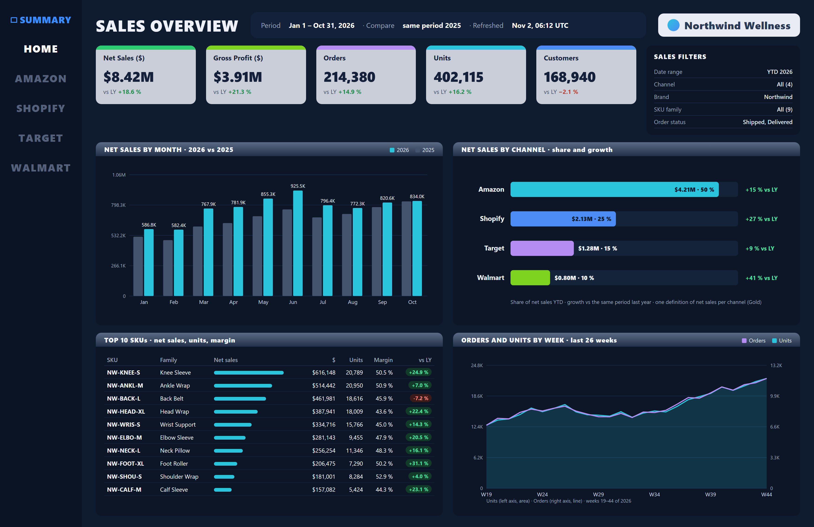
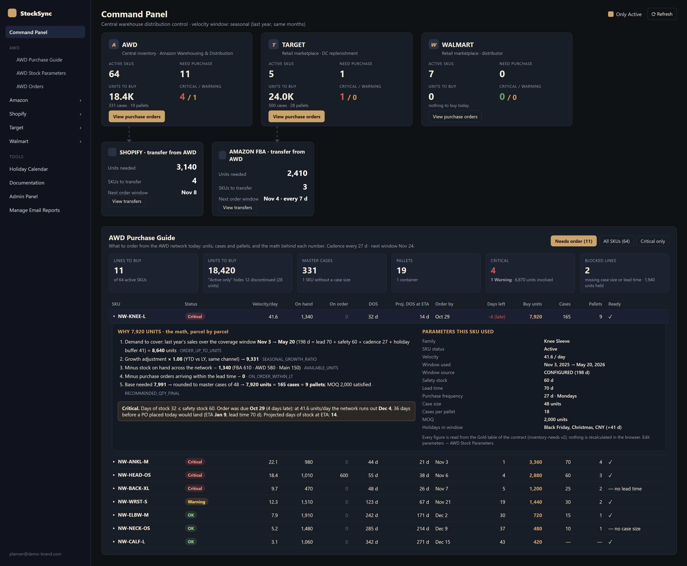
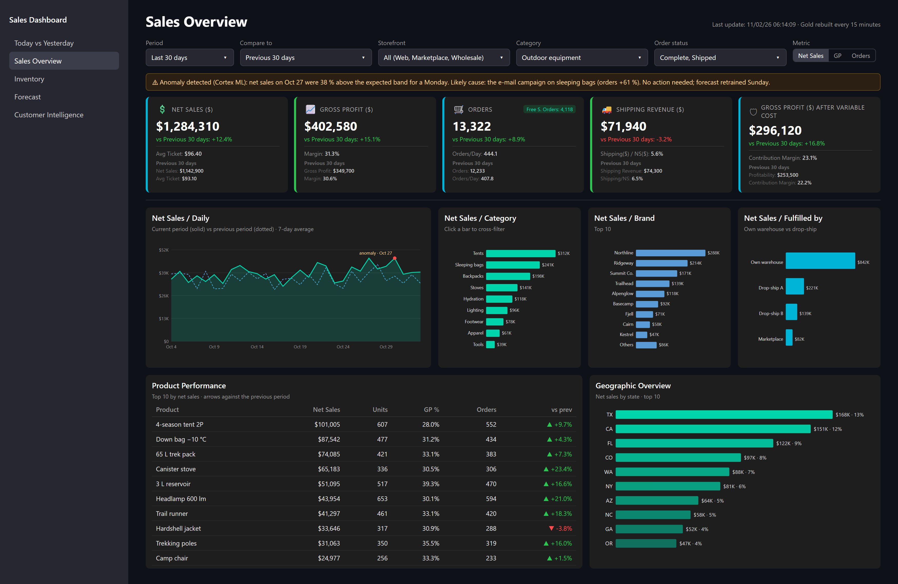

# Fabrizio Pescarmona · Data platform, BI and agentic delivery

**Data Team Lead and data solutions architect.** I architect and build multi-client data platforms on Snowflake
(Medallion layers, dbt, Dagster, CI/CD), the BI products that sit on top of them, and the agentic delivery system
that lets my team and AI agents ship through governed pull requests. Founder of Laboris AI, a labor-litigation
data SaaS that uses LLMs for structured extraction.

This repository complements my CV with **evidence**: case studies with architecture, numbers and the practices
that made each system hold, the operating model I run my team on, and a runnable reference stack.

> CV: [linkedin.com/in/fabrizio-pescarmona](https://linkedin.com/in/fabrizio-pescarmona) ·
> fabrizionpcontato@gmail.com · São Paulo, Brazil · open to remote

---

## What I do, in four pillars

| Pillar | What it means in my work | Where to look |
|---|---|---|
| **Data platform engineering** | Medallion architecture (Bronze/Silver/Gold), dbt monorepos, Dagster orchestration with CDC sensors, Iceberg lakehouse, Snowflake, CI/CD that deploys the pipeline and the apps | [CS-01](case-studies/01-multi-client-dbt-dagster-platform.md), [CS-04](case-studies/04-lakehouse-every-15-minutes.md) |
| **BI and data visualization products** | Translating a business question into a surface people adopt: KPI hierarchy, one truth per figure, self-serve filters, automated distribution, monitoring | [CS-03](case-studies/03-inventory-intelligence-product.md), [CS-07](case-studies/07-self-service-bi-and-design-process.md) |
| **Agentic delivery with engineering governance** | AI agents execute inside a governed repository: a card per task, a branch per card, pull requests under a size budget, required checks, AI review, human merge, decisions carried forward | [CS-06](case-studies/06-agentic-delivery-at-scale.md), [Playbook](practices/agentic-delivery-playbook.md) |
| **Requirements, contracts and design thinking** | Specs with EARS acceptance criteria that name their test, versioned producer/consumer contracts, acceptance tables, stakeholder review triage | [CS-02](case-studies/02-producer-consumer-contract.md), [Method](practices/requirements-and-design-thinking.md) |

---

## Two kinds of surface, side by side

The same data platform serves an **analytical** surface (explore, compare, drill) and an **actionable** one
(what to buy, how much, why). Both pages below are synthetic-data reproductions of production dashboards,
written for this portfolio; the sources are in [`demos/`](demos/README.md).

| Analytical · Sales Overview (Power BI design) | Actionable · Command Panel and Purchase Guide |
|---|---|
|  |  |
| Five KPI tiles, month vs last year, channel share, top SKUs, weekly orders and units. The reader explores. | Three purchasing channels and two transfer channels in one glance; then the lines to buy, the status rule, and the recommendation parcel by parcel with the Gold column each parcel came from. The reader acts. |

The same analytical question on a 15-minute lakehouse, in the Streamlit design language:

---

## Case studies

| # | Case study | One-line outcome |
|---|---|---|
| 01 | [Multi-client dbt + Dagster platform on Snowflake](case-studies/01-multi-client-dbt-dagster-platform.md) | 43 models, 241 dbt tests, 151 pytest tests, 10 CI/CD workflows, CDC sensors that rebuild only the downstream closure of the table that changed |
| 02 | [The contract between the pipeline and the app](case-studies/02-producer-consumer-contract.md) | A versioned contract that generates dbt contracts and TypeScript types; the first automated check found 6 real drifts, the last found 0; five copies of the purchasing engine became one (1,783 lines to 145) |
| 03 | [StockSync Pro: an inventory intelligence product](case-studies/03-inventory-intelligence-product.md) | Five sales channels, SKU-level purchase and transfer recommendations, weekly automated emails; a purchase-guide redesign validated with 11 acceptance criteria and a SQL-versus-render table |
| 04 | [A lakehouse that rebuilds every 15 minutes](case-studies/04-lakehouse-every-15-minutes.md) | ERP + e-commerce CDC to S3 Iceberg, dbt on ECS Fargate Spot synchronized 5 minutes before each Power BI refresh, Cortex ML forecasting and a text-to-SQL analyst, self-healing ingestion |
| 05 | [Laboris AI: agentic extraction that stays current](case-studies/05-agentic-extraction-platform.md) | Court filings to structured claims, outcomes and amounts; deterministic first, LLM second, a grounding harness third; 86 % of a benchmark published with confidence, the rest honestly blank; LGPD audit trail per AI call |
| 06 | [Agentic delivery at scale](case-studies/06-agentic-delivery-at-scale.md) | 2,400+ commits and ~245 pull requests in five months on one product; 448 migrations replayed from zero on every PR; AI review that comments but never approves; a quality-eval gate on prompt changes |
| 07 | [Self-service BI and the design process](case-studies/07-self-service-bi-and-design-process.md) | Power BI suites for a US e-commerce brand and a 200-user specialty minerals company; the design process from audit to boards, tokens, surfaces and validation at four widths |

## Practices

- [Agentic delivery playbook](practices/agentic-delivery-playbook.md): the operating model, step by step, with the rules that are enforced by CI rather than by memory, and the lessons that shaped them.
- [Requirements and design thinking](practices/requirements-and-design-thinking.md): how a need becomes a spec, a contract, a surface and an acceptance table.

## Reference stack (runnable)

[`reference-stack/`](reference-stack/ROADMAP.md) is the public, synthetic-data reproduction of the patterns above:
a dbt Medallion project (DuckDB locally, Snowflake-ready), Dagster definitions with a manifest-driven CDC sensor,
a versioned contract with generated types, and the CI gates (lint, build, contract, shadow build, PR size, work
item, AI review). Status and acceptance criteria are in the roadmap.

## Evidence policy

- Production code for clients is proprietary and stays private. What is public here: architecture, practices,
  measured outcomes, sanitized artifacts, and the reference stack I wrote to reproduce the patterns.
- Every number in a case study was measured in the system it describes (test counts, line counts, row counts,
  cost) and is dated where it matters.
- Client names appear only where they are already public in my CV; otherwise the client is described by sector.
