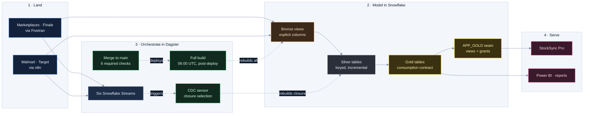

# CS-01 · A multi-client dbt + Dagster platform on Snowflake

**Role:** Data Team Lead, architect and builder (my team and AI agents execute under my direction).
**Client named in my CV:** TheraICE, a US health and wellness e-commerce brand selling on Amazon, Shopify, Walmart
and Target with inventory in Finale. A second, Salesforce-sourced client already lands its data on the same platform,
with its own ingestion destination and cost bucket; its dbt project is in onboarding.
**Period:** February 2026 to present.

## Summary

One monorepo turns raw marketplace, retail and inventory feeds into tested, consumption-ready Gold tables on
Snowflake for an inventory app, Power BI and automated reports. Each client is an isolated dbt project on shared
conventions. Dagster Cloud builds it on a schedule and on change, GitHub Actions gates and deploys it, and a cost
monitor and a client report run on the same stack.

| Measure | Value |
|---|---|
| dbt models | 43 (11 Bronze views, 18 Silver, 14 Gold) → 40 Dagster assets (3 ephemeral models are inlined) |
| dbt tests | 241 (dbt_utils, dbt_expectations: ranges, volumes, composite keys, recency, cross-table consistency) |
| pytest tests | 151 across 9 files (project setup, definitions, sensors, alerts, Fivetran health, cost monitor, reports) |
| Source tables | 21 in 7 source groups, freshness thresholds set per source cadence |
| Business parameters | 32 dbt variables, 7 of them feature flags; zero hard-coded business values |
| CI/CD | 11 GitHub Actions workflows; 6 required checks on `main` |

## The problem

Purchasing ran on spreadsheets fed by five marketplace exports. Numbers disagreed by channel, nobody could say when
a figure had been computed, and every new report started from raw data again. The brief: one warehouse, one
definition per metric, a pipeline that proves itself on every change, and apps that read consumption-ready tables.

## Architecture

## How it works

### Bronze, Silver, Gold: what each layer guarantees
- **Problem.** Raw feeds re-send rows, arrive late and change shape; a pipeline that hides this hands the app
  numbers that move for no visible reason.
- **Decision.** Bronze is a view, Silver a table or incremental, Gold a table, and each boundary carries a guarantee.
- **Mechanism.** *Bronze* mirrors one source table with an explicit column list: no storage, a dropped or renamed
  source column fails the next build instead of flowing on, a new one is ignored until selected, and parsing lives
  here (Finale's flat file is reassembled with `LAST_VALUE IGNORE NULLS`). *Silver* fixes grain, keys and late
  arrival: order lines `merge` on their natural key (`amazon_order_id`, `order_item_id`) and re-read 3 days back from
  the table's own high-water mark; daily SKU aggregates `delete+insert` on (SKU, day, channel) over the trailing 95
  days, wider than the 90-day velocity window they feed; weekly retail reports `delete+insert` because a re-sent
  report replaces its lines. *Gold* is the consumption contract: stable columns, no logic left for the app, and for
  the inventory Golds a versioned contract (CS-02). Prod writes `{target}_{layer}` schemas, dev a single one.
- **Backfill.** The schedule never backfills a widened incremental universe, so the PR that widens one carries a
  `--target prod --full-refresh` of the model and its descendants, and the downstream counts after it.
- **Proof.** When the Amazon connector had to shorten its window, 5,574,897 rows of history were frozen into an
  archive and Bronze unions archive and live source with precedence by key, not by date: the child tables carry no
  date, and the overlap would otherwise have duplicated revenue.

### Orchestration: rebuild the closure, not the DAG
- **Problem.** After Dagster's May 2026 repricing removed the included credits, a full-DAG run cost about $1.40 and
  the change sensor fired about 144 times a month. A change in the Target stream rebuilt Amazon, Shopify and the
  whole inventory branch for nothing.
- **Decision.** dbt models are Dagster assets loaded from the manifest. Three paths build them: a 06:00 UTC full
  build (the safety net, and the only refresh for sources no stream watches), one job-less CDC sensor over six
  Snowflake Streams polled every 60 s, and a post-deploy full build, because new code produces no stream event.
- **Mechanism.** The closure is a pure, tested function over the manifest's `child_map`: from the dbt source that
  names the watched table it walks model children, skips tests, traverses ephemeral models without selecting them,
  and fails loudly if no source names the table. A tick unions the closures of the streams with data
  (`SYSTEM$STREAM_HAS_DATA` does not move offsets), skips if an in-flight run of any trigger overlaps the selection
  (two dbt processes must never `MERGE` into one table), then consumes the streams with an `INSERT … SELECT COUNT(*)`
  into a checkpoint table, so offsets advance only when a run is requested. Runs carry `trigger` and `sources` tags.
- **Proof.** A new Gold model joins its closure with no code change; the six closures cover 32 of 40 assets. The
  Finale table is rewritten whole on every sync, so its append-only stream made up 84 % of all sensor activity at
  four syncs a day; the connector now syncs once a day, just after the file lands.

### Alerting: silence must not look like success
- **Problem.** In August 2026 Amazon data froze for six days while the connector re-swept its history at the API's
  rate ceiling. Fivetran said `syncing`, `_FIVETRAN_SYNCED` looked current because the re-sweep rewrote old rows,
  and the staleness alert had been paused by hand because it repeated every hour.
- **Decision.** Two sensors, both running by default in code: one for the run that breaks (Google Chat on run
  failure) and an hourly heartbeat for the run that never happens.
- **Mechanism.** The heartbeat asks three questions that fail at different moments: is there data (latest business
  date per channel), did the loader run (`_LOADED_AT`, `_FIVETRAN_SYNCED`), does the connector deliver (Fivetran's
  API). Thresholds come from 180 days of measured gaps between days with a sale (Amazon 1/1 mean/max, Walmart 7/14,
  Target 8.7/36): Amazon and Shopify alert after 2 days, Walmart after 21, Target through its loader only. A check
  that cannot run reports a problem. Repeats are suppressed by hashing the message with its digits stripped.
- **Proof.** With the 2-day Amazon threshold, the six-day freeze would have alerted on its second day.

### CI/CD: no gate passes vacuously
- **Decision.** Six checks are required on `main`: flake8, pytest, sqlfluff, `dbt parse`, `contract-lint` and the
  contract check. Every PR also runs a full `dbt build` against Snowflake and gets a Dagster branch deployment; a PR
  that touches the inventory engine gets a shadow build (CS-02); a branch without a Linear issue fails an advisory check.
- **Mechanism.** Every `env_var()` in `profiles.yml` has a dummy default, so CI parses dbt, generates the manifest
  and loads the Dagster definitions without warehouse credentials. SQLFluff runs the `dbt` templater locally and
  `jinja` in CI. Deploy is a PEX fast deploy; dev tools sit in PEP 735 dependency groups so they never ship.
- **Proof.** A required check with a path filter never runs on a PR outside the filter, and a check that never runs
  never passes. On 2026-08-04 that blocked PRs behind three workflows (lint, contract, the dbt workflow that holds `dbt parse`). Required
  workflows now run on every PR, the path filter inside the job and a no-op step that reports success; the shadow
  build keeps its filter because it is not required.

### Security: least privilege, and checks that cannot run as the owner
- **Mechanism.** Every service user authenticates with a key pair, rotated without downtime through Snowflake's
  second key slot (add the new key, switch clients, unset the old). Dagster Cloud holds the key base64-encoded and
  writes it to a temporary file at start; CI writes it from a secret to a temporary file and deletes it in an
  `if: always()` step. Ingestion has its own user, role and warehouse; the analyst role sees only Gold; the app's
  service account reads only the `APP_GOLD` seam; roles and grants live in a separate RBAC repository.
- **Proof.** The nightly build once stripped the app's access: a post-build hook recreated the seam views with
  `CREATE OR REPLACE`, which drops grants without `COPY GRANTS`, and the daily verification stayed green because it
  authenticated as the views' owner. The fix added `COPY GRANTS`, a rule that reads `SHOW GRANTS` instead of
  trusting a read as owner, and narrowed the grant from `PUBLIC` to the app's role.

### Cost: every credit has an owner
- **Mechanism.** dbt sets a `query_tag` per layer and folder (`dbt:silver:sales`, `dbt:gold:inventory`), and
  service users carry a default tag. A `CLIENT` object tag on databases, warehouses, users and roles attributes each
  query by the database it touched, weighted by execution time; one allocation query feeds both the cost monitor and
  the client report. The daily sales aggregate computes every channel in one scan with conditional aggregation.
- **Proof.** The report reconciles before it renders: provider total equals the sum of every classified bucket, a
  month over 5 % untagged compute fails, settlement is derived, and a `$` literal in a narrative fails. No gate, no
  PDF. Dagster+ measured from its own usage API once came out 26 % above its invoice, so the invoice sets the total
  and measurement only the split. The February 2026 audit put the single-scan saving at 75 to 85 %.

## Operating surfaces
- **Cost monitor** (Streamlit in Snowflake): six cost pages (Snowflake compute and storage, AWS, Dagster credits by
  job and asset, Fivetran MAR, combined) and a reports page; deployed on merge, rendered headless before deploy.
- **Self-hosted n8n** on a repo-owned, version-pinned image (no `:latest`), workflows in git, for the weekly
  Walmart and Target reports.
- **Semantic layer and MCP server** over the inventory Gold: a dedicated role with Gold-only grants, an OAuth
  integration and a client access guide, so a stakeholder asks questions in plain language against live tables.

## What it changed
- The purchasing math moved from spreadsheets to one tested engine. CS-02 tells how it was consolidated and how the
  demand rewrite cut the central-warehouse recommendation by 17.8 % by removing double-counted demand.
- The velocity model became a 247-line ephemeral and a 166-line Gold instead of one 387-line model.
- Every change runs through lint, pytest, a Snowflake build and a branch deployment before merge and, for the
  inventory engine, a shadow build that compares the PR's Gold with main's on the same window.

## How I would evolve it
Enforce dbt model contracts (`contract: {enforced: true}`) on the contracted Golds, make the PR's `dbt build` a
required check, emit dbt tests as Dagster asset checks, and declare sensor and schedule state in code, since today
a UI toggle outlives every deploy.

## Fit

Data platform engineering · dbt · Dagster · Snowflake · CI/CD · FinOps · data quality · multi-tenant design
