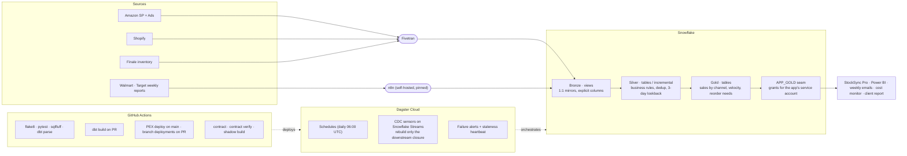

# CS-01 · A multi-client dbt + Dagster platform on Snowflake

**Role:** Data Team Lead, architect and builder (my team and AI agents execute under my direction).
**Client named in my CV:** TheraICE, a US health and wellness e-commerce brand selling on Amazon, Shopify, Walmart
and Target with inventory in Finale. A second, Salesforce-sourced client was onboarded on the same platform.
**Period:** February 2026 to present.

## Summary

One monorepo turns raw e-commerce, retail and inventory feeds into tested, consumption-ready Gold tables on
Snowflake, and feeds an inventory intelligence app, Power BI and weekly automated reports. Each client is an
isolated dbt project on shared conventions, orchestrated by Dagster Cloud, deployed by GitHub Actions, with a
cost monitor and a client reporting pipeline on the same stack.

| Measure | Value |
|---|---|
| dbt models | 43 (11 Bronze views, 18 Silver, 14 Gold) → 40 Dagster assets |
| dbt tests | 241 (dbt_utils, dbt_expectations: ranges, volumes, composite keys, recency, cross-table consistency) |
| pytest tests | 151 across 9 files (project setup, definitions, sensors, alerts, cost monitor, report generator) |
| Source tables | 21 in 7 source groups, with freshness configured |
| Business parameters | 16 dbt variables, zero hard-coded business values |
| CI/CD workflows | 10 (lint, dbt test, branch deployments, prod deploy, staging with approval, Streamlit deploy, contract, contract verify, shadow build, CodeQL ready) |

## The problem

The client ran purchasing on spreadsheets fed by five marketplace exports. Numbers disagreed by channel, nobody
could say when a figure had been computed, and every new report started from raw data again. The brief: one
warehouse, one definition per metric, a pipeline that proves itself on every change, and apps that read
consumption-ready tables rather than raw sources.

## Architecture

### Decisions that shaped it

- **Bronze is views, Silver is tables or incremental, Gold is tables.** Bronze mirrors a source with an explicit
  column list (no `select *`); Silver applies the business rules once; Gold is what apps read. A custom
  `generate_schema_name` routes prod to `{target}_{layer}` schemas and dev to a single schema for easy cleanup.
- **Incremental models use a 3-day lookback** for late-arriving marketplace data: `merge` for row-level data,
  `delete+insert` for aggregations.
- **CDC sensors rebuild the closure, not the DAG.** Each Snowflake Stream maps to the set of assets downstream of
  the table it watches, computed from the dbt manifest (a pure function with tests), so a new Gold model is picked
  up automatically. After Dagster's 2026 repricing a full-DAG run cost about $1.40 and the sensor fires ~144
  times a month; a change in the Target stream used to rebuild Amazon, Shopify and the whole inventory branch for
  nothing.
- **Key-pair authentication with zero-downtime rotation** for every Snowflake service user; CI writes the key
  from a secret and deletes it after the run.
- **Required checks never carry a path filter.** A required check with a path filter never runs on a PR that
  does not match it, and a check that never runs never passes: four PRs were blocked that way in one day. The
  rule is written at the top of each workflow so nobody reintroduces it.
- **The app reads through a seam.** `APP_GOLD` views carry the grants for the app's service account; when a
  grant was lost in a refactor, the fix became a migration and a scheduled verification against the warehouse.

## Operating the platform

- **Cost monitor** (Streamlit in Snowflake, six pages): Snowflake compute month-to-date and 90 days by tag window,
  storage by database, AWS via Cost Explorer, Dagster credits by job and asset, Fivetran MAR, and a combined view.
  Every workload carries a `CLIENT` object tag; untagged compute fell to zero by April 2026.
- **Client project report**: a Python package that collects costs per client, computes every monetary figure in
  one module, runs a reconciliation gate (settlement equals its components, no `$` literal in any narrative) and
  only then renders a PDF with charts. No gate, no PDF.
- **Self-hosted n8n** on a repo-owned, version-pinned Dockerfile (no `:latest`), with the workflow JSONs
  source-controlled, for the weekly Walmart and Target sales reports.
- **Semantic layer and MCP server** over the inventory Gold so a stakeholder can ask questions in plain language
  against live tables, with its own RBAC and OAuth client access guide.

## What it changed

- The purchasing math moved from spreadsheets to one tested engine (CS-02 tells how it was consolidated and how
  the rewrite of the demand model cut the central-warehouse recommendation by 17.8 % by removing double-counted
  demand).
- Single-scan aggregations cut warehouse compute on the heaviest models by 75 to 85 %; the velocity model was
  split into a 247-line ephemeral and a 166-line Gold instead of one 387-line model.
- Every change ships through lint, pytest, `dbt build` against Snowflake, a branch deployment, and, when it
  touches the inventory engine, a shadow build that compares the PR's Gold against main's on the same window.

## Fit

Data platform engineering · dbt · Dagster · Snowflake · CI/CD · FinOps · data quality · multi-tenant design
