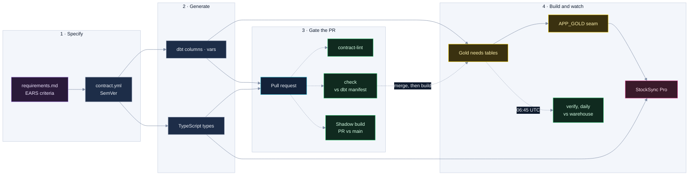

# CS-02 · The contract between the pipeline and the app

**Role:** Architect and author of the spec system, the contract, the gates and the purchasing-engine rewrite.
**System:** the inventory engine of CS-01 (producer) and StockSync Pro of CS-03 (consumer).
**Period:** July to September 2026.

## Summary

The purchasing recipe lived in seven places: five near-identical SQL models (one per channel), an older copy, and
fragments re-implemented inside the app. The agreement between the pipeline and the app existed nowhere. I made the
recipe exist once, wrote the contract down as a versioned artifact that generates code on both sides, and put
automated checks on every change and every day. The first run of the check found six real problems; by the end
there were zero.

| Before | After |
|---|---|
| 5 channel models, 1,783 lines of duplicated SQL | 1 engine (a macro with a per-channel configuration object) + 145 lines of channel files |
| A 4,052-line gateway with 71 actions in one `else if` chain and 4 operations written twice (the second copy never ran) | A 118-line flow (authenticate, dispatch, respond) plus a handler registry where a duplicate is an error at load |
| A new Gold column ignored by the app for 3 weeks, shown as blank | A contract check on every PR, and a daily verification against the real tables |
| One business rule ("30 to 365 days of history") declared on both sides with a comment saying "change it there too" | The app derives its limits from the contract; `contract_sync.py drift` fails if it redeclares them |
| 29,600 units in the app vs 32,128 in the pipeline for the same SKU | One number, with its provenance, on every surface |

## How a change travels



```
specs/
├── contracts/inventory-needs-v2/
│   ├── contract.yml        # single source: 5 Gold tables , their seam views, a companion table
│   ├── requirements.md     # the problem, user stories, EARS acceptance criteria
│   ├── CHANGELOG.md        # SemVer on the contract, not the code
│   └── generated/          # dbt column block, dbt vars, TypeScript types: regenerated, never hand-edited
├── features/<slug>/        # requirements.md · design.md · tasks.md
└── _bugfix/<slug>/         # actual vs expected, root cause, prevention
```

## How it works

### `contract.yml` is the source, not documentation
- **Problem.** Each side assumed what the other did. The pipeline shipped a column the app served as `NULL` for
  three weeks, and a business rule lived in both repositories.
- **Decision.** One versioned file per producer and consumer boundary, owned by the producer.
- **Mechanism.** It declares each column in contractual order with type, nullability, enum values, the version that
  introduced it and a `consumer_status` (`WIRED`, `NOT_YET_WIRED`, `PRODUCER_ONLY`), so unconsumed columns are visible
  debt. `contract_sync.py generate` emits the dbt column block (types and constraints), the dbt vars and the app's
  TypeScript types. `drift` reads the app's code and fails when a contract parameter is redeclared as a literal,
  when the app reads the physical schema instead of the seam, or when a `WIRED` column is only ever served as
  `NULL`; a column still unwired is a warning that becomes an error after two releases.
- **Proof.** Drift went from 6 errors and 40 of 58 columns covered to 0 errors and 58 of 58. Its first version
  raised 15 false positives, because nulling a column in one of 71 actions is legitimate; the rule became "nulled
  somewhere and never selected anywhere", and they went to zero.

### SemVer on semantics, changes behind flags
- **Decision.** MAJOR means a column removed, renamed, retyped, or whose meaning changed; MINOR an added column, enum
  value or channel; PATCH metadata. A refactor gets no bump: if the contract changes, the refactor failed.
- **Mechanism.** Engine changes ship behind a dbt var that defaults off, so the merge itself is output-neutral.
  The shadow build measures the flag-on effect, and switching the flag on is the bump, with the measurement in the
  changelog. `contract-lint` fails a PR that edits a contracted Gold model without touching the contract.
- **Proof.** Six MAJOR versions shipped between 2026-08-03 and 2026-08-05 and none moved a column: each changed what
  a number means. In 8.0.0 the coverage indicators switched to the demand rate the purchase used and the number
  changed in five channels, while `recommended_qty_final` was measured identical for every SKU in every channel.

### Two gates: the manifest and the warehouse
- **Problem.** The dbt manifest only knows columns declared in YAML, so a column the engine stops emitting is
  invisible to it. Measured on 2026-08-04: 0 errors, 189 warnings, and 189 of 265 contract columns out of its sight.
- **Decision.** `check` compares contract and manifest on every PR, with no credentials, and is required on `main`.
  `verify` runs daily at 06:45 UTC, after the build, against `information_schema`: name, type and ordinal position
  of every built Gold table, and the shape and grants of every seam view. It is deliberately not required: it
  depends on warehouse state, not on the diff, so a failure is an operational alarm.
- **Mechanism.** Order matters because the shadow diff compares with `select * minus`. The app reads only
  `APP_GOLD` views, and Snowflake freezes a `select *` view's column list at creation, so a post-build hook recreates
  each seam view, with `COPY GRANTS`, in the same production run that rebuilt its Gold.
- **Proof.** The first `verify` found `last_inventory_ts` declared `timestamp_ntz` while all five tables had
  delivered `timestamp_tz` since 2.0.0. On 2026-08-04 a new Gold column broke the seam (view declared 77 columns,
  query produced 78) until the views were recreated by hand; the hook made build and seam one operation. Later, the
  daily check passed on a seam the app could not read, because it authenticated as the views' owner: access is now
  checked by reading `SHOW GRANTS` for the consumer's role, never by reading as owner.

### Shadow build: same window, both sides
- **Problem.** Comparing a PR with production mixes data drift with the change, because current stock reads the
  current inventory state. And the recommended quantity depended on the day the build ran: a shadow built on another
  day diverged in about seven columns with no bug present.
- **Decision.** Build base and new in the same window, in throwaway schemas, and diff them channel by channel.
- **Mechanism.** Base is the merge-base with `main` on a PR and the previous commit on the daily run. Both sides
  build with the date anchor pinned by a `run_date` var (rendered as `to_date('…')`: unquoted, a date renders as
  arithmetic) and `--indirect-selection=cautious`, so tests whose other parent is out of scope do not run against
  unbuilt tables. The diff is a bidirectional `minus` plus schema shape per channel. The job skips when the
  inventory subgraph is identical (a vacuous green is worse than none), runs in one concurrency group, and drops
  exactly the schemas it created, failures included.
- **Proof.** The engine consolidation was promoted on zero rows of difference in both directions: Target 4 rows,
  Walmart 7, Shopify 108, Amazon FBA 54.

### Requirements that name their proof
Every feature that changes a Gold column or a planner-visible behaviour carries `requirements.md`, `design.md` and
`tasks.md`. Acceptance criteria are written in EARS and **each one names the test that proves it**:

> **AC-4 (unwanted)** IF `sales_horizon_days` is outside 30 to 365, THEN the pipeline SHALL clamp it to the
> limits and still report `window_source = 'CONFIGURED'`. → test: `expect_column_values_to_be_between(30, 365)`

> **AC-7 (zero-diff)** WHEN no SKU has a horizon configured, the output SHALL be identical to the build before
> the feature. → verification: `analyses/validate_sales_horizon_zero_diff.sql`

`design.md` names its patterns ("Template Method with a Configuration Object" is reviewable; "a macro that takes
the channel" is not). `contract-lint` turns the structure into checks: every cited spec exists, the algorithm lives
in one macro (no channel model holds its body), and a channel model holds at most 15 lines of code. On its first run
it failed the very PR that introduced it, which cited a `requirements.md` in three places and never wrote it. The
specs moved out of a gitignored tool folder, where thirteen design documents had been invisible to PR reviewers and
to the consuming repository.

## The engine rewrite: a total is not a rate

The old formula averaged daily sales over one window (30 to 365 days, planner-chosen) and stretched that rate flat
across a 198-day coverage period. Demand is not flat, and the purchase is the thin residue of two large numbers
(about 447,000 units of demand against 806,000 available across 73 SKUs), so small errors in the rate became large
errors in the order. The rewrite sums what actually sold last year over the exact months being covered, then
adjusts for growth measured as daily rates over each side's exposure, so a SKU launched mid-year no longer inflates
its own ratio. Proof that the window stopped steering the purchase: moving the horizon from 90 to 150 days moved the
old engine's recommendation by +52.0 % and the new one's by 0.0 %, on the same data and date. The central-warehouse
recommendation fell 17.8 % (16,681 to 13,720 units) because the old method double-counted demand that was not
there. Both changes shipped behind flags, switched on by the stakeholder after the shadow build. One business
question only the client could answer (which channels the central warehouse supplies) was escalated rather than
guessed. Its first answer left Shopify out although that warehouse's stock already fed Shopify; contract 5.0.0 put
Shopify demand back, and the changelog records the correction.

## How I would evolve it
Switch on `contract: {enforced: true}` for the five Golds (the generated column block already carries data types),
so `dbt build` itself fails on a missing or retyped column; run `verify` against the shadow schema so the warehouse
check also gates the PR; and add dbt unit tests for the engine's clamps and its partial-history branch.

## Fit

Requirements engineering · data contracts · spec-driven development · dbt · analytics engineering · BI governance
