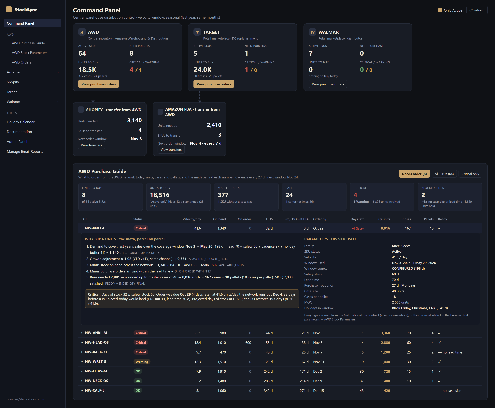
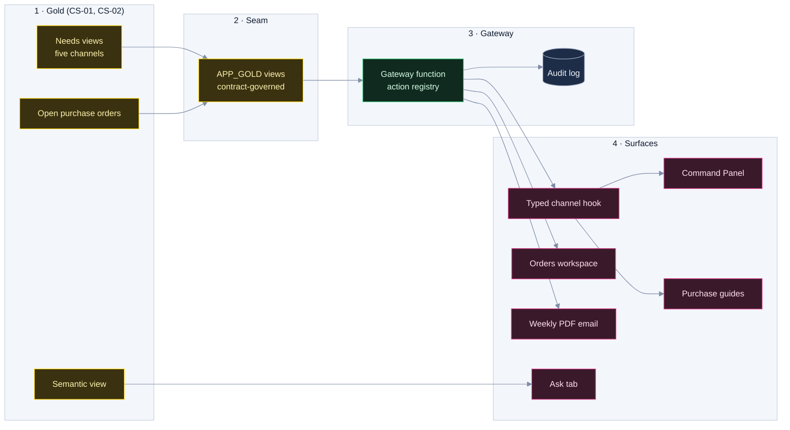

# CS-03 · StockSync Pro: an inventory intelligence product

**Role:** Product owner, architect and builder of the data product end to end (pipeline in CS-01, contract in
CS-02, app, emails). **Client named in my CV:** TheraICE. **Users:** the supply planner and the operations team.
**Stack:** React 18 + TypeScript + Vite + shadcn, TanStack Query, Recharts; Supabase (Auth, Postgres with RLS, Deno
edge functions, pg_cron); Snowflake Gold behind one gateway function; Cortex Analyst; PDF email reports; AWS EC2 (app hosting).
**Period:** December 2025 to present.

| Measure | Value |
|---|---|
| Channels | 5 (AWD, Amazon FBA, Shopify, Target, Walmart): three buy, two receive transfers |
| Gateway | one 4,052-line function with 71 actions in one `else if` chain became a 118-line flow plus a handler registry |
| Acceptance | 11 criteria, every one verified against the warehouse (SQL × render) on 2026-08-05 |

## The question the product answers

Every week the planner decides, per SKU and per channel: **what to buy or transfer today, how much, what is at
risk, and whether the order document can be issued.** Before StockSync Pro that decision came from five
marketplace exports and a spreadsheet, with no shared definition of "days of stock".

[](../assets/command-panel-purchase-guide.png)

*Synthetic-data reproduction of the Command Panel and the AWD Purchase Guide, one row expanded to show the math
parcel by parcel. Source: [`demos/command-panel-stocksync.html`](../demos/command-panel-stocksync.html).*

## What it does

- **Command Panel**: five channels in one screen. AWD (the central network), Target and Walmart **buy** from
  suppliers; Amazon FBA and Shopify **receive transfers** from AWD. Per channel: active SKUs, SKUs needing an order,
  units, cases and pallets.
- **One purchase guide for five channels**: velocity, stock by bucket, days of stock, reorder date, ETA, projected
  days of stock at ETA, units, master cases, pallets, whether the line can become a document, status.
- **Per-SKU parameters** written back to the warehouse (safety stock, lead time, purchase frequency, order day,
  packout, sales horizon, bundles, a holiday calendar with shipping blackouts), and an **Orders workspace**.
- **Weekly PDF emails** per channel for people who never open the app, and an **Ask tab** for plain-English questions.

## The data path



- **Seam.** The app reads the needs views and the open-PO view in one seam schema, never the physical Gold
  tables, so a pipeline cutover replaces what is behind the views (branch by abstraction) without an app deploy.
- **Gateway.** The browser never holds a warehouse credential. One edge function verifies the user's JWT, resolves
  the action in a registry, runs it as a key-pair service user, and logs every write with old and new values. It
  replaced a 4,052-line file with 71 actions in one `else if` chain; in the registry a duplicate action fails at load time, and
  the old chain held four calendar actions written twice whose second copy never ran.
- **Typed client.** The contract generates the TypeScript row types and the business constants; a drift check
  compares what the gateway selects with the contract (59 of 59 columns after the Orders release, 0 errors). A channel's guide and
  dashboard share one hook and one query, so one question has one answer.
- **Security.** Row-level security on every table; three roles (`admin`, `user`, `logistics`) read by a
  `SECURITY DEFINER` function with a pinned `search_path`, so policies on the roles table do not recurse. Role
  assignment is admin-only; only the service role writes the audit and send logs; users read their own audit rows.

## One status rule, as a pure function

A first version of the guides invented its own words ("Late / Before next window / On cadence") on the screen where
the dashboard said Critical / Warning / OK about the same SKUs. Two rulers for one question. Now one module:

```ts
export function purchaseStatus(row: StatusRow): PurchaseStatusKey {
  if (row.daysOfStock === null) return "noVelocity"; // no sales, no DOS: an absent answer, not a severity
  const safety = row.safetyStockDays > 0 ? row.safetyStockDays : 14; // the app's long-standing fallbacks, not contract parameters
  const lead = row.leadTimeDays > 0 ? row.leadTimeDays : 30;
  if (row.daysOfStock <= safety) return "critical";
  if (row.daysOfStock <= safety + lead) return "warning";
  return "ok";
}
```

The command panel, the guides, the dashboard's health bar and the email worker all import it (the worker through
the edge functions' shared folder), so a SKU cannot be Critical on one surface and OK on another. On AWD data the 12
lines to buy split 4 Critical, 1 Warning, 7 OK: the 7 are the scheduled top-up, where v1 had put 8 lines under
"Before next window". The reorder date became a column: *when* next to *how severe*, not instead of it.

**Overstock left the status scale.** The dashboard's fifth band ("Excess", at a hard-coded 180 days) held 41 of 58
active SKUs and "Healthy" held 0: a band that swallows 71 % of the catalogue classifies nothing. Overstock became a
separate badge defined by the Gold's own target, `days_of_stock > order_up_to_days`. The 180-day rule contradicted
the engine on 6 of 46 SKUs; the Gold rule flags 35, and none of them has a buy line.

## The KPI tile rule and the expanded row

- **A missing metric shows a dash and the reason, never 0.** The tile's `unavailable` reason replaces the value. It
  exists because the Command Panel once rendered `formatNumber(0)` after a failed query: a zero that looked
  measured. A measured zero is a fact and renders as a dimmed `0`. Every definition is one hover away.
- **The expanded row shows the math in five steps**, each parcel named with its Gold column: velocity and window,
  cover and order-up-to units, stock and on-order, the gap, the case rounding. The coverage identity (safety + lead
  + holidays + order cycle) is printed only when the Gold's columns add up. With nothing to order the row becomes
  "why there is nothing to order yet", with the reorder point and its date. It replaced a 260-px "How it works"
  column that hard-coded a 30-day review period while the Gold used 27 days for AWD and 7 for Amazon.
- **One component, a configuration per channel**: the verb (Buy or Transfer), the document it issues, whether days
  of stock count open POs (FBA's do not), the cadence (read from the Gold). Four page files (841, 861, 564 and 225
  lines) and a hook became one component.

## Nothing is recalculated in the client, proved by a bug

The Orders page computed each ETA in the browser and was wrong by up to 5.6 years. The gateway serialized
Snowflake `NUMBER` as a string, and `addDays(date, "46")` concatenated it with the day of the month: day 21 plus
"46" became day 2146, so the error grew with the day of the month: +145 days on the 1st, +2,145 on the 21st. It also used the 46-day freight time instead
of the 70-day lead time the purchase engine uses. The fix moved the ETA into the Gold (an open-purchase-orders view
in the seam), and the acceptance caught a fan-out on the way: the PO-line join went from 120 to 184 rows until it
aggregated first. Checks: 120 = 120 rows, units and value equal on both sides, 0 ETAs before their order date.

## The weekly email pipeline

`pg_cron` calls a worker function every two minutes. Recipients, frequency, day, time and time zone are set per
channel in the app; a schedule is due inside a 60-minute window after its local send time, and only if it was not
sent that local day. Before building anything the worker inserts a run key (schedule, local date, time, zone) into a
send log with a unique constraint: a second worker hits the constraint and skips, so an overlapping tick never sends
twice. It then calls the gateway as the service role, renders one PDF per channel with the status of every line,
and sends it. Each run ends as sent, failed or skipped, with the provider's message id: the log is the delivery
monitor.

## Acceptance, measured (data of 2026-08-05)

| # | Criterion | Verification | Result |
|---|---|---|---|
| AC1 | KPIs match the Gold in all five channels | SQL aggregation per channel × the real render | identical |
| AC2 | The status rule is the app's one rule | same module, same fallbacks as the dashboard | yes |
| AC3 | "No velocity" ≡ no DOS | `count_if(days_of_stock is null)` = `count_if(velocity_15d = 0)` in 5 views | equal in all |
| AC4 | "All SKUs" shows the date of SKUs with nothing to order | render with `?scope=all` | 58 SKUs, 12 with an order, 46 with a date |
| AC5 | The status filter filters | render `?scope=all&st=critical` | "4 of 58 SKUs" |
| AC6 | What "Active only" hides is said | render default | "15 discontinued hidden (30 units)" |
| AC7 | Cadence comes from the Gold, per channel | render Amazon × the others | every 7 days × every 27 days |
| AC8 | A channel with nothing to buy is not an error | render Target | "Nothing to buy today" + link to All SKUs |
| AC9 | Nothing is recalculated in the client | read the diff | units, cases, pallets and containers come from the Gold's `RECOMMENDED_*` columns |
| AC10 | No slice breaks | 14 scenarios over 5 channels rendered on real rows | 14/14 |
| AC11 | Build gates | `tsc`, `deno check`, `eslint` on touched files, `vite build` | pass |

## What CI guards

Until August 2026 the app had no CI, and the 4,052-line gateway refactor was validated by hand. Four jobs now run
on every pull request: `deno check` on every edge function, `tsc --noEmit` on the frontend, ESLint (advisory until
the inherited backlog is cleared: 137 errors down to 125, new files at 0), and a guard that the contract-generated
types file keeps its generated header, so a hand-written copy fails. A lint rule turns a raw framework colour or a
hex literal in a component into an ESLint error (advisory, like the rest of ESLint, until the backlog clears): colour comes from the design tokens. Edge functions do not execute in
CI; runtime behaviour is proven by the acceptance table.

## How the product cycle ran

| Stage | Artifact | Example |
|---|---|---|
| Ask | The stakeholder's words, quoted | "You click and things disappear"; "this ETA predicts 2032" |
| Specify | A design doc: what is wrong, what changes, how each claim is verified | Five sidebar defects named; the ETA traced to string concatenation |
| Build | One pull request per concern, the pattern named | A configuration object for five channels; a handler registry for the gateway |
| Accept | The acceptance table, SQL × render on real rows | The table above |
| Review | The stakeholder sees the screen; corrections come back as a second PR | Guides v1 → the status and scope corrections |
| Sign off | The stakeholder accepts the table; the card closes with its evidence | Each accepted table linked from its card |

## Adoption and distribution

- The weekly email reaches people who will never open the app; the send log shows what reached them.
- The Ask tab (July 2026): Cortex Analyst writes SQL over a governed semantic view, a read-only role runs it on a
  dedicated warehouse, and the answer shows the interpretation, the SQL and the rows. It reads the same Gold: no new
  pipeline.
- A monthly client report (CS-01) shows the platform's cost per source and month, with a validation gate.

## Fit

BI product · data visualization · self-serve analytics · requirements to acceptance · React · Supabase · Snowflake
