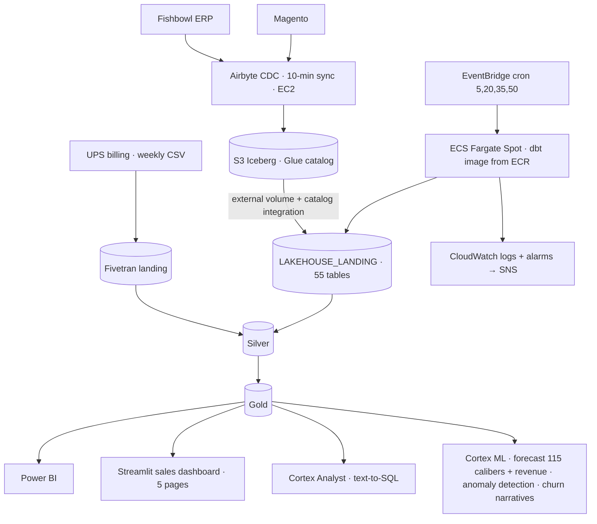
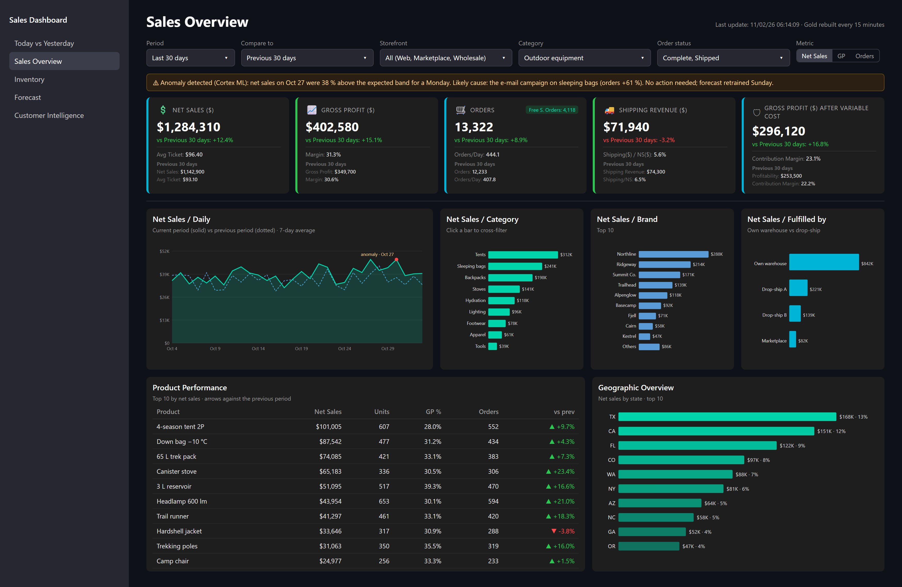

# CS-04 · A lakehouse that rebuilds every 15 minutes

**Role:** Data Team Lead, architecture and delivery owner; built with my team.
**Client:** a US e-commerce retailer (ERP: Fishbowl; storefront: Magento; carrier billing: UPS).
**Period:** April 2025 to present (Redshift era), Snowflake + Iceberg since April 2026.

## Summary

ERP and e-commerce change data lands in S3 as Iceberg through Airbyte CDC, Snowflake reads it through an external
volume, and dbt rebuilds 104 models on ECS Fargate Spot every 15 minutes, five minutes before each Power BI
refresh window. Gold serves Power BI, a Streamlit sales dashboard, an infrastructure monitor, a text-to-SQL
analyst and ML forecasts. Ingestion heals itself.

| Measure | Value |
|---|---|
| Landing | 55 unmanaged Iceberg tables (34 ERP, 21 e-commerce), refreshed in parallel by a sidecar (8 threads, ~15 s warm) before every build |
| Silver | 76 models (69 views, 7 high-fan-out tables) |
| Gold | 14 tables (`d_` / `f_`, UPPER_CASE for Power BI) + 14 intermediate views; `f_sales` incremental merge, 3-day lookback |
| Build | 104 models in about 3.5 minutes, every 15 minutes, on 0.5 vCPU / 1 GB Spot (about $3.70 a month of compute) |
| Custom generic tests | 8 (`assert_*`) plus dbt_utils; freshness warn 24 h, error 48 h |
| Decisions and incidents | 9 architecture decision records, 4 incident postmortems |

## Architecture

### Decisions, recorded as ADRs

- **Retire Redshift, keep one snapshot** with indefinite retention and the two resources a restore needs.
- **dbt core on ECS Fargate** rather than a managed scheduler: production is whatever `main` builds; every push
  to `main` that touches the project builds the image, and the next scheduled run uses it.
- **Iceberg lakehouse, option B**: Airbyte writes Iceberg to S3 with a Glue catalog; Snowflake reads it unmanaged
  through an external volume, so the lake is not locked to the warehouse.
- **Cortex over an external LLM** for forecasting, anomalies and narratives: the data never leaves the warehouse.
- **The dbt cadence follows Power BI**: measured from `QUERY_HISTORY`, the refresh windows are :00/:15/:30/:45,
  so the build fires at :05/:20/:35/:50.
- **Keep Airbyte on abctl** after evaluating the version 2 upgrade path.

### The race every production fix is in

Each scheduled run rebuilds from the latest image. Anything done to production that `main` does not already
contain is overwritten within 15 minutes. The runbook says it plainly: commit and push first, wait for the image,
then run the model with `--target prod`; a fix that needs DDL merges first, confirms the image is in ECR, then
runs the DDL. A 42-column fix once fell back to 11 columns because it was built locally first.

## Self-healing ingestion

- **Snowflake-native freshness alerts**: a view over the landing's extraction timestamps and two edge-triggered
  `ALERT` objects (warn at 25 minutes, alert at 30) that email operations.
- **Auto-remediation Lambda**: tier 1 cancels and restarts a stuck sync through SSM; tier 2 bounces the Airbyte
  control plane when tier 1 leaves staleness above 60 minutes; a DynamoDB circuit breaker, a global 6-hour cooldown
  on bounces, S3-list verification that data actually landed, and an audit log table. Two of the four incident
  postmortems are about the remediation itself (a 13-hour outage, and a bounce of a healthy platform), and each
  changed a threshold or a guard.

## Serving layer

*Synthetic-data reproduction of the Sales Overview page: period vs previous period on every card, the anomaly
banner from the ML model, cross-filterable breakdowns, product performance and geography. Source:
[`demos/sales-overview-streamlit.html`](../demos/sales-overview-streamlit.html).*

- **Power BI** reads Gold directly; the `_exposures.yml` says who reads what, and no Gold column is removed,
  renamed or retyped without the matching Power BI change (Power BI caches the schema).
- **Streamlit in Snowflake**: a five-page sales dashboard (today vs yesterday with anomaly alerts, sales overview,
  inventory and open POs, forecast with reorder recommendations, customer intelligence with RFM segment health);
  a six-page infrastructure monitor (compute, storage, AWS, Airbyte health); a Cortex Analyst chatbot over a
  semantic view with 20 golden queries and a 25-question smoke test.
- **Static dbt docs** deployed to S3 on every merge.

## Governance the team runs on

- No work without an issue: the branch carries the Linear identifier and a CI check fails a PR without it.
- A pull request stays under about 300 changed lines (lockfiles and generated files aside); a CI check counts
  them and a `large-pr` label, with the reason in the PR, is the exception a person grants.
- `AGENTS.md` in every directory holds the rules for the code beside it (invariants, "never" lists, traps);
  knowledge that is not a rule lives in `docs/` (architecture, decisions, incidents, runbooks).
- A change is done when `dbt build` passes and, when it moves row counts, when the before/after on production
  data is in the PR.

## Fit

Lakehouse · CDC · Iceberg · Snowflake · dbt · AWS (ECS, Lambda, EventBridge, Secrets Manager) · Power BI · Streamlit · Cortex ML · observability
