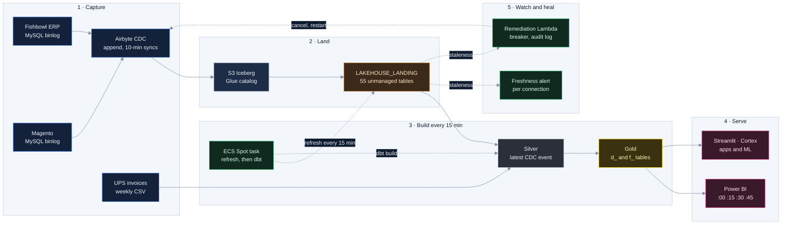

# CS-04 · A lakehouse that rebuilds every 15 minutes

**Role:** Data Team Lead, architecture and delivery owner; built with my team.
**Client:** a US e-commerce retailer (ERP: Fishbowl; storefront: Magento; carrier billing: UPS).
**Period:** April 2025 to present (Redshift first; Snowflake since March 2026; the Iceberg lakehouse since April 2026).

## Summary

ERP and e-commerce change data lands in S3 as Iceberg through Airbyte CDC; Snowflake reads it in place. dbt rebuilds
Silver and Gold on ECS Fargate Spot every 15 minutes, each build starting ten minutes ahead of the next Power BI
refresh. Gold serves Power BI, Streamlit apps, a text-to-SQL analyst and ML forecasts. Stuck ingestion is detected
inside Snowflake and recovered by a Lambda with a circuit breaker.

| Measure | Value |
|---|---|
| Landing | 55 unmanaged Iceberg tables (34 ERP, 21 e-commerce), refreshed in parallel (8 threads) before every build; a failed refresh stops the build; UPS invoices arrive as a weekly CSV into a landing table and join Silver by tracking number |
| Silver | 76 models (66 views, 10 high-fan-out tables) |
| Gold | 14 tables (`d_` / `f_`, UPPER_CASE for Power BI) + 15 intermediate models (3 as tables); `f_sales` incremental merge, 3-day lookback |
| Build | every 15 minutes, about 3.5 minutes warm (about 6 cold), on 0.5 vCPU / 1 GB Spot (about $3.70 a month of compute) |
| Tests | 8 custom generic tests (`assert_*`) plus dbt_utils; key tests on `f_sales`, `d_product`, `d_customer` are errors, the rest warn; freshness warn 24 h, error 48 h |
| Decisions and incidents | 9 architecture decision records, 4 incident postmortems |

## Architecture

## How it works

### The lakehouse: ingestion compute out of the warehouse
- **Problem.** Airbyte loaded both sources straight into Snowflake, and its service user burned 678 credits a
  month: 74 % of all compute.
- **Decision (ADR 0004).** Airbyte writes CDC as Iceberg to S3, cataloged in Glue; Snowflake reads it in place as
  unmanaged Iceberg tables through an external volume and a catalog integration, copying nothing into its storage.
  A full DuckDB lakehouse was built as a proof of concept and set aside: this option kept 85 % of its savings at
  near-zero complexity.
- **Mechanism.** Unmanaged tables see new commits only after `ALTER ICEBERG TABLE … REFRESH`. A sidecar refreshes
  all of them on 8 threads, one connection each (the connector is not thread-safe), and any error stops the run: a
  build from a stale catalog ships wrong numbers. Iceberg business timestamps arrive as `TIMESTAMP_LTZ`, so Gold
  casts back to `TIMESTAMP_NTZ` to keep Power BI's cached schema.
- **Proof.** The ingestion user fell from about 22.6 credits a day to about zero within minutes of the 2026-04-07
  cut-over. The parallel refresh measured 41 s warm, 48 s cold, against 87 s and 320 s for the serial dbt hook.
- **Also recorded.** Redshift retired with one indefinite snapshot and the two resources a restore needs (ADR 0001);
  Airbyte stays on abctl because its destination writes CDC to Iceberg with deletes in one hop, which dlt (no
  native MySQL binlog CDC) and AWS DMS (no Iceberg) cannot (ADR 0009).

### CDC semantics: Silver turns events into current state
- **Problem.** Both connections are incremental append: every insert, update and delete lands as a new row with
  `_ab_cdc_updated_at` and `_ab_cdc_deleted_at`, and NULL-key rows the old MERGE dropped now arrive.
- **Decision.** Bronze is source YAML over the landing tables; Silver is one model per source table that returns
  current state; it is a view unless many Gold models read it.
- **Mechanism.** Each Silver model ranks a key's events by `_ab_cdc_updated_at` (extraction time as fallback), keeps
  the latest with `QUALIFY ROW_NUMBER()`, then drops the key if that latest event is a delete; it guards NULL keys,
  renames to snake_case and casts. Ten high-fan-out models are tables, so the dedup scan is paid once per build
  instead of once per reader.
- **Proof.** Materializing the three Magento EAV value tables, then scanning each once, took the attribute lookup
  from about 164 s to 5.6 s, row parity checked (120,682). After a re-snapshot, landing held about four times the
  rows (7.8 M against 1.8 M orders) until old Iceberg generations were cleaned; Silver's dedup kept the right count.

### Gold: a contract with a consumer that caches the schema
- **Decision.** Gold is transient `d_` / `f_` tables with UPPER_CASE columns. `_exposures.yml` says who reads what,
  no Gold column is removed, renamed or retyped without the matching Power BI change, and a new consumer gets a
  wrapper view instead of a new shape.
- **Mechanism.** `f_sales` merges on `ID` and re-reads the last 3 days of orders. Marketplace orders that exist
  only in the ERP enter with negative IDs so they never collide with Magento's. A fix that moves money ships behind a
  var that defaults to false, under which the model renders today's production SQL exactly.
- **Proof.** One such fix found configurable products costed from a parent item that has no cost: 55 % of 2026
  revenue fell to a frozen fallback. It merged switched off; turning it on, or back off, is one line. A one-day
  rewrite of `f_sales_realtime` once blanked Power BI's Yesterday card for two weeks, so it keeps four days.

### The cadence follows Power BI (ADR 0006)
- **Problem.** dbt ran every 10 minutes, 144 builds a day, for a consumer whose cadence nobody had measured.
- **Decision.** A 14-day audit of `QUERY_HISTORY` showed Power BI refreshing at :00/:15/:30/:45 with no dark hour.
  EventBridge now starts the build at :05/:20/:35/:50, ten minutes ahead of each refresh: about 3.5 minutes warm and
  6 cold leaves 4 to 7 minutes of margin.
- **Mechanism.** The build warehouse is extra small with a 60-second auto-suspend, yet its spend is flat by hour
  (17 % between quietest and busiest over 30 days): each build pays the spin-up whatever it does, so the lever is
  build count. Skipping builds when Iceberg is unchanged was built and parked: a far worse return on complexity.
- **Proof.** 144 builds a day became 96; the lag the build schedule adds went from about 5 to 7.5 minutes, 15 at worst.

### Deploy: production is whatever `main` builds (ADR 0002)
- **Decision.** dbt-core runs as an ECS Fargate Spot task instead of dbt Cloud and MWAA. A push to `main` that
  touches the project builds an image (commit tag and `:latest`); the next scheduled run uses it. Deploy became
  automatic because it was once forgotten: after nine commits, ECS ran a stale image for hours.
- **Mechanism.** The entrypoint runs the Iceberg refresh (fatal), source freshness (recorded), `dbt build` and
  `dbt snapshot` (non-fatal), and publishes the build duration; alarms for a failed build and for no run in 30
  minutes mail through SNS.
- **Proof, and the race it creates.** Anything in production that `main` lacks is overwritten within 15 minutes:
  a hotfix is pushed first and run with `--target prod` once the image exists, and DDL waits for the new image. A
  42-column fix once fell back to 11 columns because it was built locally first.

### Self-healing ingestion, with brakes (ADR 0008)
- **Problem.** Syncs froze: a live job, zero bytes, no progress, and each freeze needed a person to cancel and
  restart it over SSM.
- **Mechanism.** Two layers on two delivery paths, so switching remediation off never silences detection. A view
  takes each connection's staleness from its busiest stream (a minimum would alarm on idle config tables); a
  Snowflake `ALERT` emails when a connection crosses its own threshold, kept in a table (warn/alert 30/45 minutes for
  Magento, 60/90 for the ERP) and set from measured gaps between extracts. A Lambda checks a per-connection DynamoDB
  breaker and a progress gate (skip only on positive evidence that counters advance), pages a person for a failed
  job, and leaves alone one that succeeded within the hour or is too young to have committed. Tier 1 cancels and
  restarts the sync over SSM and verifies by listing S3; Tier 2 runs `docker restart -t 120` on the control plane past
  60 minutes stale, behind a 6-hour cooldown. Each tier has an observe-only switch; each decision, an audit row.
- **Proof.** One global 25/30-minute threshold had sent about 27 emails in 26 hours. Two of four postmortems are
  about the remediation. In the first, an expired binlog offset made a failing connection look frozen and the
  restart, run without `-t`, killed containerd mid-write (13 hours down); in the second, two days later, it restarted
  a healthy platform. Each changed a guard; Tier 2 went back to observe-only for a soak. The honest limit: Magento ran 78 minutes stale on average over
  30 days, 200 at worst, so detection is moving to Airbyte's own job state.

## Serving layer

*Synthetic-data reproduction of the Sales Overview page: period vs previous period on every card, the anomaly
banner from the ML model, cross-filterable breakdowns, product performance and geography. Source:
[`demos/sales-overview-streamlit.html`](../demos/sales-overview-streamlit.html).*

- **Power BI** reads Gold directly. **Streamlit in Snowflake**: a five-page sales dashboard (today vs yesterday with
  anomaly alerts, sales overview, inventory and open POs, forecast with reorder recommendations, RFM segment health);
  a six-page infrastructure monitor (compute, storage, AWS, combined, dbt pipeline, Airbyte health); a Cortex
  Analyst chatbot over a semantic view with 20 golden queries and a 25-question smoke test.
- **Cortex, not an external LLM (ADR 0005)**: the client provides no external LLM API keys, so forecasts (115
  calibers, the retailer's product groups, and revenue; retrained weekly), anomaly detection and narratives run on Cortex, with no secret to manage.
- **Access**: key pairs for the dbt and ingestion users (key from Secrets Manager), one role per function, Power BI
  on its own warehouse and, since MFA enforcement, a `TYPE = SERVICE` user; every user carries a `QUERY_TAG`.

## Governance the team runs on
- No work without a Linear issue (a CI check reads the branch); a PR stays under about 300 changed lines (lockfiles
  and generated files aside), counted by a required check, unless a person grants a `large-pr` label with a reason.
- `AGENTS.md` in every directory holds the rules for the code beside it; knowledge that is not a rule lives in
  `docs/` (architecture, decisions, incidents, runbooks); static dbt docs deploy to S3 on every merge.
- A change is done when `dbt build` passes and, if it moves row counts, its before/after on production is in the PR.

## How I would evolve it
A PR job that builds `state:modified+` with `--defer` in a zero-copy clone, so the before/after is generated, not
pasted; an `f_sales` lookback on the CDC change time, so a refund on a month-old order reaches Gold; the ECS task
pinned to an image digest; CI on GitHub OIDC instead of static AWS keys.

## Fit

Lakehouse · CDC · Iceberg · Snowflake · dbt · AWS (ECS, Lambda, EventBridge, Secrets Manager) · Power BI · Streamlit · Cortex ML · observability
