# CS-05 · Laboris AI: agentic extraction that stays current

**Role:** Founder, architect and builder (2,400+ commits of my own since June 2026).
**Product:** a labor-litigation data SaaS for large employers (automotive, steel, healthcare, food service) with
portfolios of thousands of active lawsuits in Brazil.
**Stack:** Python collectors (Playwright, Docker), Supabase (PostgreSQL, Auth, Storage, 22 edge functions in
Deno), LLM extraction (Gemini on Vertex AI in São Paulo, Claude), React + TypeScript on Cloudflare Pages.

## Summary

Court records are collected incrementally per company, every filing becomes a structured row, the figures that
matter (what is being claimed, what was decided, what was paid) are extracted by a layered pipeline, and the
published analytics are always the current state. One isolated database per client; seven instances in
production, demo and benchmark; 766 migrations; 505 pull requests.

## The data flow, in layers

```mermaid
flowchart LR
    subgraph collect["1 · Collect"]
        ceat["Discovery per company<br/>official per-company source"]
        integra["Full case files<br/>authenticated read"]
        granular["Filing by filing<br/>timeline, parties, hearings, documents"]
    end
    subgraph structure["2 · Structure (edge functions)"]
        det["Deterministic extractors<br/>PDF geometry, printed totals, regex"]
        llm["LLM extractor<br/>classifies claim vs calculation"]
        harness["Grounding harness<br/>every value must exist in the text layer"]
        agree["Two-model agreement<br/>when publishing above the stated cause"]
    end
    subgraph publish["3 · Publish (per-client PostgreSQL)"]
        facts["Facts: claims, outcomes, amounts,<br/>deadlines, settlements"]
        mv["Materialized views on pg_cron<br/>jurimetrics, provisioning, benchmarks"]
        ui["Dashboards · case pages · review queue · feed of what changed"]
    end
    ceat --> integra --> granular --> det --> llm --> harness --> agree --> facts --> mv --> ui
```

### Why "deterministic first, LLM second, harness third"

The target is the amount a worker is claiming plus its breakdown. On a 155-case benchmark:

| Stage | What it did | Publishable cases |
|---|---|---|
| Geometry extraction + confidence cut | reads x/y coordinates of the PDF, finds the value column, reconciles to the printed total | 44 (98 % accurate, 0 over-claims) |
| Asymmetric rule | without a printed total, the sum of the claims is the value and the stated cause is only a ceiling; under is normal, over is a red flag | 44 → 77 |
| LLM as a judge of already-extracted items | prunes claim vs argument | +3 (not worth it) |
| LLM as the extractor | re-reads the whole document and classifies each line; the harness rejects any value not present in the text layer; a second model must agree within 5 % before publishing above the cause | +55 |
| **Result** | 78 deterministic + 55 grounded LLM | **133 of 155 (86 %)**; the other 22 stay honestly blank |

The single fix that unlocked the LLM stage was not a prompt: the extractor was being fed the first 16,000
characters, the argument section, and the claims sit at the end. Head plus tail windowing turned four anchor cases
from zero claims to complete extraction. The documentation says in its own words what the harness does not
guarantee (an under-extracted claim, a shared bias between the two models) and what measurement is still owed.

### Always current

- Discovery is incremental and idempotent: a composite key per (company, court, case), first-seen immutable,
  last-confirmed updated every round, rows never deleted, status history in a separate table.
- The feed shows what changed since the user last looked; a public initial load is not a novelty.
- Materialized views for jurimetrics (outcomes by claim type, settlement benchmarks, provisioning by judge and by
  court) refresh on `pg_cron`, so the dashboard reads a snapshot that is never older than its schedule.

## Governance and compliance (LGPD)

- **Data residency**: Vertex AI in São Paulo; **minimization**: a redaction pass before every model call, with
  counts per category; **audit trail**: one row per AI call (provider, location, model, characters in, redactions)
  written best-effort with a 2.5 s timeout so it never stalls the call; **retention**: TTL plans and purge jobs.
- **Read budget**: a central schema (13 tables, idempotent reservations with a 20-minute lease,
  daily / 7-day / 30-day windows, incident records, 23 tests) that approves or denies each court read before it starts, so no client instance can exhaust the shared read budget.
- **Per-client isolation**: one Supabase project per client, a typecheck gate on every front deploy, an
  instance-topology document that answers "does this front point at the right database" from the published
  bundle, and a drift audit after one instance was provisioned from a stale baseline.

## Engineering practice

- 14 GitHub Actions workflows: parser tests, AI queue tests, liquidation tests, a schema/view/UI sync check on
  every PR that touches migrations or the UI, secret scanning, per-client front deploys.
- Edge-function test harnesses that run the whole function against a fake PostgREST and a fake model gateway.
- Every phase of the AI queue ships with an acceptance SQL, a local test and a rollback SQL.

## Fit

Agentic data pipelines · LLM extraction with grounding · PostgreSQL · Supabase · Python · Deno · LGPD · multi-tenant SaaS
