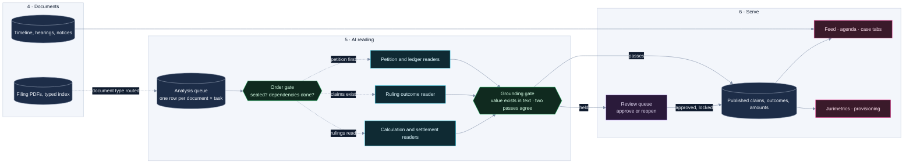

# CS-05 · Laboris AI: signals that trigger ingestion, in layers

**Role:** Founder, architect and builder (2,200+ commits of my own since June 2026).
**Product:** litigation intelligence for large employers (food service, healthcare, steel, automotive, facility
services) with portfolios of thousands of labor lawsuits in Brazil.
**Stack:** Python collectors, Supabase (PostgreSQL, Storage, 22 Deno edge functions, pg_cron), Gemini on
Vertex AI in São Paulo, React + TypeScript on Cloudflare Pages. One database per client; seven instances.

## The idea in one sentence

Public signals say *which* cases changed; the platform reads only those, in layers of increasing cost
(public timeline → full case file → filing PDFs → AI reading); every layer emits the signal that arms the
next; and every screen reads a materialized current state that says its own freshness.

| Measure | Value |
|---|---|
| Change detection | the judiciary change feed catches 92 to 94 % of changed cases on the same or next day |
| Petition reader | 133 of 155 benchmark cases published with confidence (86 %): 78 by rules, 55 by model with grounding; the other 22 held |
| Claims ledger engine | line recall 83 → 97 %, precision 94 → 98 % on 120 documents; 94 to 97 % recall across three client instances |
| Liquidation reader | 45 of 60 cases reconciled to the cent, 100 % precision where it closes; 36 of 38 court-approved totals exact |
| Deadline reader | deadline length right in 36 of 40 hand-checked cases, calendar arithmetic 38 of 38, 88 of 88 gazette notices captured |
| Provisioning back-test | the estimator landed within 1.06× and 1.12× of what was actually paid in the mature year; the prior median method was off 2.3× to 7× |
| Delivery | 766 migrations, 505 pull requests, 14 CI workflows, 25 collector test modules |

## Stages 1 to 4 · from a signal to the documents

```mermaid
%%{init: {"theme":"base","themeVariables":{"primaryColor":"#13223a","primaryTextColor":"#eef2f8","primaryBorderColor":"#2bc4dd","lineColor":"#7f8da6","secondaryColor":"#0f1b2e","tertiaryColor":"#1d2d48","clusterBkg":"#f3f6fb","clusterBorder":"#c7d0e0","titleColor":"#0f1b2e","fontFamily":"Segoe UI, Helvetica, Arial, sans-serif","fontSize":"14px"}}}%%
flowchart LR
    classDef source fill:#13223a,stroke:#4c8cf5,color:#eef2f8
    classDef gate   fill:#102a1f,stroke:#2ecc71,color:#d7ffe6
    classDef store  fill:#1d2d48,stroke:#9aa6bb,color:#eef2f8

    subgraph S1["1 · Signals"]
        FEED["Judiciary change feed<br/>daily, every changed case"]:::source
        CERT["Official per-company source<br/>new and open cases"]:::source
        HOOK["Partner case webhook"]:::source
    end
    subgraph S2["2 · Discover"]
        DAY{{"Feed day check<br/>vs 28-day median"}}:::gate
        REG[("Case registry<br/>first seen · last confirmed · history")]:::store
    end
    subgraph S3["3 · Timeline"]
        QUEUE[("Read queue<br/>clock + priority band")]:::store
        PUB[("Public timeline<br/>movements · hearings · state")]:::store
        SIG{{"Signal families<br/>rulings · liquidation · execution"}}:::gate
    end
    subgraph S4["4 · Documents"]
        BUD{{"Read budget<br/>per court"}}:::gate
        FULL[("Full timeline<br/>notices · parties · document index")]:::store
        PDF[("Filing PDFs<br/>typed, by mode")]:::store
    end

    FEED --> DAY
    DAY -.->|normal day, not yet read| QUEUE
    CERT --> REG
    REG -.->|new case| QUEUE
    QUEUE -.->|due or prioritized| PUB
    PUB --> SIG
    SIG -.->|family armed| BUD
    BUD -.->|reservation granted| FULL
    HOOK -->|"documents delivered directly"| FULL
    FULL --> PDF
```

| Layer | What enters | What it does | Idempotency and cost control |
|---|---|---|---|
| **Signals** | The judiciary's daily change feed; an official per-company source of new and open cases, per court; a partner webhook for one client | The feed is filtered to the instance's cases and classified per day against the 28-day median of the same weekday class; the per-company source is diffed against the registry; the feed catches 92 to 94 % of changed cases on the same or next day | A day is processed once; an inflated day (6 to 32 % precision when measured) is never applied; a low or absent day sends the queue back to the clock |
| **Discover** | Results of the per-company source | New cases enter the registry with an immutable first-seen date and are promoted into the read queue (every 15 minutes, 25 per tick, only in courts registered for full reads); missing cases are marked gone, returning ones reappeared | Key (company, court, case); rows never deleted; one canonical case shared by the group's companies (47 % of the pilot's cases were duplicates across subsidiaries) |
| **Timeline** | A claimed queue job | The public read writes the public documents, movements, hearing agenda and case state, and emits signal families (ruling, liquidation, execution, hearing) | Movements identified by a hash of (case, level, minute, title); upsert, never delete; a feed notice for a day already read does not advance the job (175 and 257 redundant visits removed in two instances); daily ceilings per instance; backoff 30 → 240 minutes |
| **Documents** | An armed signal, an unconfirmed deadline, a new case, or silence | A central read budget grants a reservation per run; the full read indexes every filing with 50+ attributes, then downloads PDFs by mode (everything, what the product consumes, or what a litigation manager would open) | Filing-by-filing PDFs (about 77 MB per case) instead of the monolithic file (about 107 MB); mode 1 cut a 60-day window from 36,393 PDFs and 13.9 GB to 19,543 and 5.0 GB; the index is complete even when a PDF is skipped, with the reason recorded |

## Stages 5 to 6 · from documents to what the user sees

### The AI reading, by document type

| Document | Rules first | Model second | Gate third | Measured |
|---|---|---|---|---|
| Initial petition → claims and amounts | PDF geometry finds the value column; printed total within 3 % closes the case; sum above 1.05× the stated cause is a red flag, below 0.70× is held | Only for held documents: a re-read of the head and the tail of the text (the claims sit at the end) with a class per line: claim, calculation, reasoning, total | Every value must exist in the text layer; publishing above the stated cause needs two model passes within 5 % | 133 of 155 published; 99.1 % of rule-read values and 88.6 % of model-read values grounded in text before the gate (160 documents) |
| Initial petition → claims ledger | Text windowed to the value-dense pages (82 to 86 % of input cut) | Three passes: which printed number is the total, then text, then image only if still open | Certification seal: printed total within 0.2 % strong, cause value with backing within 1 % medium, text and image converging within 0.5 % consensus, otherwise abstain | recall 97 %, precision 98 %, documents within 1 % error 52 → 78 %; swapping models did not move the money error |
| Rulings → outcome per claim | Nature-of-action rules (what a given court level may decide; execution never touches merit); a copy filed by a party must belong to the case | Verdict per claim (granted, partial, denied, extinguished, upheld, annulled) plus the decision block | Waits for the claims; approval lock; the current view folds decisions by precedence liquidation > appeal > sentence | 99.2 % of claims carry no amount in the sentence (the quantum comes from liquidation) |
| Calculation sheets, expert reports → liquidation | Geometry summary; reconciliation: corrected + interest = total | Vision only behind a gate | Cent-exact or review, never a guess | 45 of 60 cases cent-exact; 36 of 38 court-approved totals exact |
| Homologation decision → which account the court approved | The decision names the document or the value | Only when the rule cannot decide | Only an answer that validates in the text becomes a record; more swaps than a ceiling writes nothing and raises an alarm; a 31-case human gold set agrees in 29 | 366 accounts, 220 confirmed, 52 % of payable value |
| Ruling that set a deadline | Finds the act and reads the length; guards for narrative, other party, stale act | none | Writes only when the act has exactly one distinct deadline | 36 of 40 lengths, 38 of 38 dates, 88 of 88 gazette notices |

Shared guards: a sealed document or a secret-of-justice case is skipped at the queue trigger; readers run in
dependency order (petition → ledger → rulings → calculations and settlements); each dispatch is an atomic claim
with a ceiling; a daily circuit breaker on total model calls, built after one loop produced 357 invocations in
23 hours; every reader can be switched to shadow per instance.

## What "always current" means

1. **The registry versions, never deletes.** First seen is set once; last confirmed moves with every
   discovery run; status history is append-only (discovered, gone, reappeared).
2. **An initial load is not news.** An act captured by a job that had no earlier successful read is dated at
   the act, not at its arrival. In one instance this took the "since your last visit" block from 71 decisions
   to 0; other instances reclassified 1,102, 87 and 72 acts and kept 7, 2 and 1 real novelties.
3. **"Since your last visit" asks when an act became visible, not when it was signed.** Measured lag:
   sentences appear a median of 1 day after signature (max 37), appellate rulings 6 (max 16), homologated
   settlements 28 (max 42). The window was raised from 180 to 270 days because of it.
4. **A bad feed day falls back to the clock.** Nothing depends on a single signal source.
5. **Humans win and history is kept.** Manual rows are never overwritten; approved claims are locked against
   re-extraction; every edit appends who, what and when; every extraction appends an immutable snapshot;
   provisioning is frozen daily (the three-scenario estimator was back-tested against what was actually paid: within 1.06× and 1.12× in the mature year).
6. **The screen states its own freshness.** Materialized views refresh every 5 to 10 minutes; the feed shows
   the real time of its last refresh and polls counts every 5 minutes.

## The alerts the user sees, and the one that was removed

- **Feed** cards for movements and documents, hearings and new cases, with a severity from 0 to 100 (a hearing
  within 3 days is critical; a sentence, a hearing this week or an archiving is high); a hot branch of 90 days
  and a history branch with the same filters.
- **Agenda** of hearings with status (designated, rescheduled, cancelled, held) and calendar export; **case
  tabs** for timeline, documents, notices, hearings and claims; the **"since your last visit"** block.
- **Deadlines left the feed.** The product rule is that a signal below 95 % accuracy at screen grain is not an
  alert. End to end, as a card showed it, due dates were right within one business day in 71 % of cases and 11 of 12 cards shown as overdue were
  already closed at court, so deadlines moved to the case's Notices tab with an owner class (63 % of open notices
  belonged to the other side) and a confidence seal. The measuring instruments stayed, to reopen the decision
  when the number clears the bar.
- **Operator alarms** are separate from user alerts: hourly freshness per route and court (median and p90 days
  since the last good read, overdue armed jobs, hearings past without an outcome, feed recall), AI queue health
  (loops, bursts, stale processing, daily ceiling), deduplicated per condition and hour.

## Governance (LGPD)

Residency: every model call goes to a Brazilian region. Minimization: identifiers are masked before any call,
with the redaction counts recorded. Audit: one row per AI call with provider, region, model, document type,
characters sent and outcome, purged after 24 months with the purge itself logged. Retention: a nine-category
matrix with legal basis and term; PDF purge is a dormant function behind three locks. Isolation: one database
per client; the end of a contract is the drop of the database; the cross-client benchmark is de-identified.

## Engineering practice

Fourteen CI workflows (parser tests, AI queue tests, liquidation tests, a schema/view/UI sync check on every PR
that touches migrations or the UI, secret scanning, per-client front deploys gated by typecheck); edge-function
harnesses that run the whole function against a fake PostgREST and a fake model gateway; every AI phase ships
with an acceptance SQL, a local test and a rollback.

## Fit

Event-driven ingestion · PostgreSQL · Supabase · Python · LLM extraction with grounding · data quality gates · LGPD · multi-tenant SaaS
