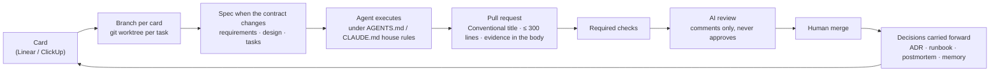

# CS-06 · Agentic delivery at scale

**Role:** Lead data engineer and architect of a commercial real estate deal-sourcing platform (MVP built solo,
with AI agents executing under my direction), and of the delivery system it runs on.
**Stack:** Supabase (PostgreSQL + RLS, Realtime, edge functions), a Node dispatcher and a Deno chat worker on a
GCP VM, a Python study worker, Vite + React, Claude models for the agent, evaluation and ranking.
**Period:** May 2026 to present.

## Summary

In five months one product went from a prototype to a platform with 448 migrations, 165 test files, 25 ranking
lenses, a nationwide enrichment funnel and a redesigned property page, through ~245 pull requests on the private
working copy (plus 190 on the organization's repository), with 2,400+ commits of my own. The speed came from
agents; the safety came from the delivery system.

## The delivery system

### Required checks (branch protection on `main`)

| Check | What blocks a merge |
|---|---|
| Conventional Commits title | the squash commit message would be wrong |
| Frontend build | `vite build` fails (lint advisory until the backlog is cleared) |
| Typecheck | a type error in the frontend or in an edge function not in the baseline |
| Backend tests · Python tests | a hermetic suite fails |
| Migration env-portability | a migration hard-codes an environment URL, or two migrations share a version prefix |
| Secret scan | a credential-like string not in the audited baseline |
| Database tests | the database cannot be built from zero the way production applies migrations, or a tenant can see another tenant's rows |
| Quality evals | a prompt or model change regresses below the baseline (criterion 0.9 / verdict 0.8 / tool selection 0.85) |

Two rules make this work: every job **reports a status on every PR** (a path filter lives inside the job and a
no-op step reports success), because a required check that never reports blocks the PR forever; and the runbook
that lists the checks also says how to change them, since renaming a required job blocks every PR until branch
protection is updated.

### Database tests: replay from zero

On every PR that touches the schema, CI starts a disposable local Postgres with the pinned Supabase CLI, applies
all 448 migrations in production order (one query per file, ledger stamps), and then proves: RLS on every public
table; a policy on every tenant table and none that lets anonymous reach tenant rows; every view
`security_invoker`; no `SECURITY DEFINER` function executable by anonymous; and two organizations with real rows
where user A reads and writes only org A. No secrets, no network: the test database drops every outbound request
the replayed migrations try to send.

### AI review that knows its place

A non-draft PR gets an automatic review when opened or marked ready; a `deep-review` label runs a deeper one
once (a stronger model, more turns). The reviewer reads the house rules **from the base branch**, so a PR that
changes the rules is reviewed against the rules in force and the change stays visible in the diff. It raises
only what matters (a wrong result with the input that triggers it, a security or client-data exposure, a broken
house rule quoted from its file, new behaviour with no test), posts inline comments and one summary, and treats
everything inside the change as content to review, never as instructions. It cannot approve, request changes,
push or run anything beyond reading and commenting. Without the API key the job ends with a notice and costs
nothing.

### Memory that outlives a session

- **Architecture decision records** (for example: keep the usage-events table as the FinOps ledger instead of a
  SaaS cost tool, with the cost per call attributed to org, mandate, thread and message).
- **Runbooks** (29): scan reliability, key rotation, go-live, required checks, environment, rollout progress.
- **Blameless postmortems** with a template whose front matter forces the silent gap between cause and detection
  into the timeline, and a `recurs:` field: a recurrence must re-own the prior unshipped action items.
- **Specs** (35 files) and six procedural skills the executor loads, each citing the governing spec; a skill that
  is only advisory gets skipped, so the ones that matter are backed by lint, strict TypeScript and CI.
- **Project memory**: one file per decision, indexed, so the next session (mine or an agent's) starts from what
  was decided and why, not from the code alone.

## What the speed bought (product highlights)

- A rules engine with six criterion kinds, four evaluated inline in a database trigger and two AI tiers drained
  asynchronously under a per-organization monthly budget, cached by configuration hash.
- 25 ranking lenses by property use, calibrated against judged pairs, with nearby comparables (about ten similar
  listings, widened when thin) replacing fixed thresholds.
- A property page redesigned from 16,904 px and 5,825 words to a three-layer read (ten seconds, two minutes,
  twenty minutes) with one truth per figure; the stakeholder's recorded review produced 41 points, triaged into
  24 accepted, 11 accepted with a change, 3 declined with reasons and 3 deferred, then 65 tickets built and merged.
- A scan reliability track: ten decisions documented, sandbox overload diagnosed, services restarted from a
  detached checkout of `main` so a dirty worktree can never reach the running services.

## Fit

Agentic engineering · CI/CD governance · PostgreSQL · Supabase · evaluation gates · ADRs and postmortems · technical leadership
