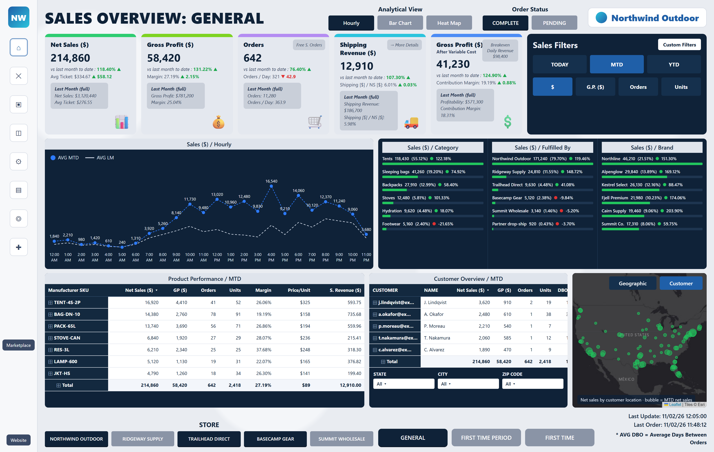
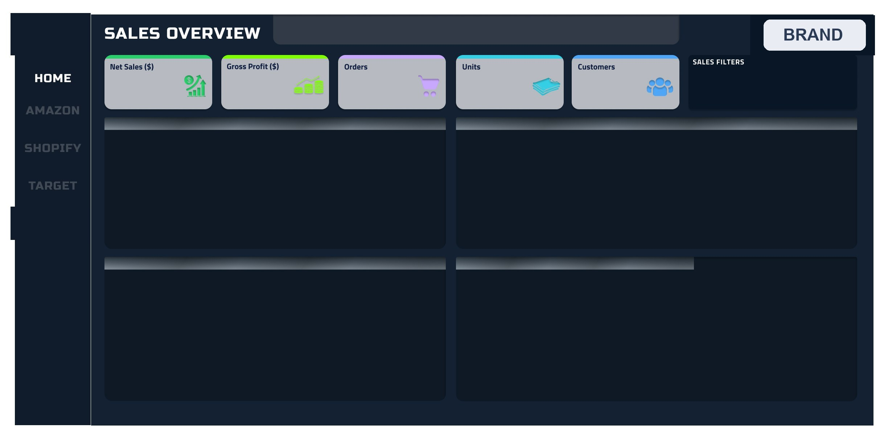
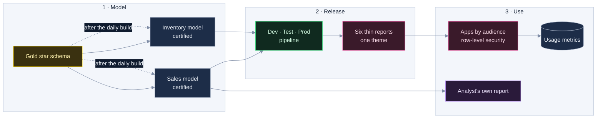

# CS-07 · Self-service BI and the design process

**Role:** BI architect and builder; Microsoft Certified: Power BI Data Analyst Associate (PL-300).
**Where:** TheraICE (US e-commerce, 2024 to 2025), ICL South America (specialty minerals, 2023 to 2024), Siemens
Healthineers (2021 to 2022), and the design track of the deal-sourcing platform in CS-06 (2026).

## Summary

Thirty-plus dashboards for sales, inventory, marketing and executive teams, built on one design system per client
so a new page looks like the last one and a user who learned one learned all. Self-serve means the user answers the
next question without a ticket: a certified model whose numbers they trust, standardized filters, consistent KPI
tiles, drill paths that keep the context, and apps published by audience. Measured on the latest track: first paint
0.85 s on a production build, text under AA contrast from 893 nodes to 0.

## The design process, as a method

Each stage ends with an artifact a reviewer can disagree with, and the next stage does not start until it exists.

| Stage | Artifact | Gate to the next stage | Where it ran |
|---|---|---|---|
| 1. Discover | A measured baseline and the open questions, each with an owner | The problem stated in numbers | The property page: 16,904 px, a figure said in up to nine places |
| 2. Define | The questions the page answers, in order; a KPI dictionary (definition, grain, filters, owner) | The stakeholder agrees the questions and the definitions | The purchase guide's five questions (Method); metric definitions aligned with each client |
| 3. Audit | Every surface captured by script; a table per surface ("what works, what is slop, what is missing") and a verdict out of 10 | Every surface has a verdict | The shell scored 4 of 10: the chrome louder than the work |
| 4. Information architecture | The home of each object, the routes, the navigation, each decision with its reason | No object has two homes | The property opens as a layer, so "Back" always returns to its origin |
| 5. Direction boards | Two boards of the same screens; the choice written trait by trait | A reason for every trait taken | A blend: one board's cool canvas, the other's navy ink and display face |
| 6. Design system | Tokens, re-skinned primitives, new primitives, one provenance mark | The token sheet renders from the live stylesheet | Type scale, 4-pt spacing, three radii, a hairline and a lift, motion that honours reduced-motion |
| 7. Surfaces | One pull request per surface with its before and after | Captures at every width attached; the visual baseline updated | Shell, chat, property page, the rest of the app |
| 8. Validate | SQL × render, four widths × two themes, pixel baseline, accessibility, timed walk, bundle | Every budget below met or the miss recorded | The table in the next section |
| 9. Review | A recorded walk-through and a triage table | Every point decided: accepted, changed, declined with a reason, deferred | 41 points on the property page mock |
| 10. Operate | Distribution, usage and cost monitoring | A page nobody opens is a bug | The weekly email of CS-03; the usage review below |

On the deal-sourcing platform the brief was an application a broker opens twenty times a day in a 1,750-px window,
judged in ten seconds. A script signs in, visits each route, captures it at 1,750 × 1,000 in light and dark, and
signs out; where the test account could not reach data, the surface was audited from its code and the missing
"before" capture was logged as a debt and taken later. The design system lives in CSS variables mapped to utilities,
and the token sheet is a development route that reads the live stylesheet, so it cannot drift. Every older token
name was kept with its new value, so every page inherited the system without a rename.

## Accessibility and performance budgets, measured

| Budget | Target | Measured |
|---|---|---|
| First paint of the listing's own figures | under 1 s warm | 0.85 s cold, 0.84 s warm, on a production build |
| Largest contentful paint | under 1.5 s | 1.10 s on the same production build |
| Text contrast | every visible text node at WCAG AA | densest page: 893 of 4,392 nodes under AA before, 0 of 4,394 after; the chat (6 of 507) and the rules page (7 of 91) keep separators and small figures below AA, listed |
| Structural accessibility | no issue | 0 on the 10 signed-in surfaces |
| Bundle | main chunk and stylesheet within 10 % | JavaScript 2,855 → 2,432 kB (minus 15 %); CSS 242 → 295 kB (plus 22 %, the miss recorded) |
| Visual regression | pixel change per surface against a 1,280-px baseline | reported per pull request, both themes |
| The broker's day | a scripted, timed walk | 7.8 s from portfolio to compare and back |

A script runs axe's deciding checks and the contrast of every text node inside the page; the formal axe and
Lighthouse runs wait on the rule that the track adds no dependency. The 1-second target holds on a production
build, not on the development server, and the report says so.

## The Power BI suite at TheraICE

Six reports on one design system: Amazon, Shopify, Target, a second brand, Inventory, Consolidated. One
shell: a left rail with the channel pages, a sales-overview header, five KPI tiles (net sales, gross profit, orders,
units, customers) with one semantic colour per measure across every report, a filter panel in a fixed place, the
brand mark where the eye expects it. Executive first, detail on demand: the first page answers the week in five
numbers and two charts, and every tile drills to the SKU without leaving the filter context.

[](../assets/sales-overview-powerbi-design.png)

*Synthetic-data page in the suite's design language. Source: [`demos/sales-overview-powerbi.html`](../demos/sales-overview-powerbi.html).
The production shell, captured without data (brand marks replaced); report pages with client data stay private:*

[](../assets/powerbi-shell-template-all-channels.jpg)



- **Model.** Import mode on the Gold star schema: facts at order-line grain, conformed Date, Product, Channel and
  Customer dimensions, single-direction relationships. One certified model per domain (Sales, Inventory), so a KPI
  means the same in every report, and the same definitions were carried into the Gold layer of CS-01. Reports are thin and bind live to the
  model; an analyst with Build permission makes a new report on it without copying data.
- **Measures.** Explicit measures only, named `[Metric]`, `[Metric] LM`, `[Metric] vs LM %`, in display folders with
  a description that shows in the field list. Time intelligence is a calculation group and the metric switch
  ($, GP, orders, units) a field parameter, so a page holds one visual per question, not one per metric:

```dax
Net Sales = SUM ( Sales[Net Amount] )                      -- one definition, used by every report

-- calculation group "Period", applied to whichever measure is in the visual
MTD vs LM % =
VAR cur  = CALCULATE ( SELECTEDMEASURE (), DATESMTD ( 'Date'[Date] ) )
VAR prev = CALCULATE ( SELECTEDMEASURE (), DATEADD ( DATESMTD ( 'Date'[Date] ), -1, MONTH ) )
RETURN DIVIDE ( cur - prev, prev )                         -- blank, never an error, when last month is empty
```

- **Theme and template.** One theme JSON per client: a semantic colour per measure, severity colours reserved for
  status, text classes and visual defaults; a `.pbit` template carries the shell, so a new report starts on it.
- **Security.** Dynamic row-level security from a user-to-scope table filtered by `USERPRINCIPALNAME()`, tested
  with "View as" for each role before a release; workspace roles for builders, app audiences for readers.
- **Refresh.** Incremental refresh on the fact tables (`RangeStart` and `RangeEnd` folded into the Snowflake query:
  recent days refreshed, history kept), triggered after the daily Gold build instead of on a fixed clock, so a
  report never reads a half-built layer.
- **Release.** A deployment pipeline (Dev, Test, Prod) with a parameter rule that points each stage at its own
  database; the model kept as a project in git, so a measure change is a reviewed diff with Best Practice Analyzer
  rules in CI.
- **Performance.** Performance Analyzer on every page before publishing; a visual whose query dominates the page
  gets a simpler measure or an aggregation table; DirectQuery only where freshness demands it, behind import-mode
  aggregations.
- **Accessibility.** Theme colours checked for AA contrast on their backgrounds; status never by colour alone (a
  word or an icon beside it); alt text on every visual; a set tab order.
- **Adoption.** The usage metrics of each app (viewers and views per page, per week) reviewed monthly with the
  report owners: a page nobody opens is merged or removed, and a question that arrives as a ticket becomes a
  measure or a page.

## ICL South America and Siemens Healthineers

- At ICL: reporting infrastructure for commercial and portfolio decisions in a specialty minerals company. 20+ dashboards for 200+ users; ETL in Azure SQL and Power Query that productionized
  collection, transformation and visualization and cut manual processes by 60 %; a standardized theme and
  template so non-technical teams could build on it; apps published with department-level access instead of file
  sharing.
- At Siemens Healthineers: Power BI over SAP and operational data, with Dataflows that cut manual reporting by 70 %.

## The property page redesign

It started from a measured problem (16,904 px with everything open, the same figure said in up to nine places
against three comparison pools) and a stated hierarchy: what the buyer needs in ten seconds, in two minutes, in
twenty minutes. I reviewed the mock on a recorded walk-through; each of the 41 points was weighed against the
product's own rules, not taken as given (accepted, accepted with a change, declined with the reason, deferred).
After the build the open page measured 4,529 px (CS-06).

## Rules I apply to every analytical surface

1. Write the question the page answers before drawing anything; order the blocks by the reader's time.
2. One truth per figure: one home, one comparison set, provenance on hover.
3. One status rule for the whole product, in one module every surface imports.
4. A missing metric shows a dash and the reason; a measured zero is a dimmed `0`.
5. Nothing is recalculated on the client; the surface reads the contract or the certified model.
6. Validate against the warehouse (a SQL × render table) before calling a page done.
7. Distribute to the people who will not open the dashboard: a weekly email with the decisions, not the charts.
8. Monitor adoption and cost; a page nobody opens is a bug.

## Fit

Power BI · DAX · semantic models · self-serve BI · design systems · UX process · stakeholder review · accessibility
