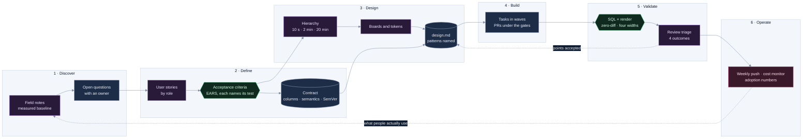

# Requirements and design thinking: how a need becomes a solution

The method I use to turn a stakeholder's need into a data product people adopt. Each stage names the artifact it
produces and the example from my work that shows it. CS-07's design track expands stage 3 into audit, information
architecture, boards and design system; the playbook's delivery loop runs inside stage 4.

## 1. Discover: watch what people actually do

- **Shadow the user, not the request.** Planners were editing `LEAD_TIME_DAYS` to change the demand window,
  because the same field served two purposes. The need was not "a bigger lead time"; it was a second concept.
  The fix was a separate `SALES_HORIZON_DAYS` with its own limits, and the logistics field left alone.
- **Find the question only a human can answer, and ask it.** "Does the main warehouse supply only Amazon, or
  also the other channels by transfer?" decided whether the old engine was inflating purchases. No tool answers
  that; the stakeholder does, and the answer was recorded with the decision.
- **Measure the current state before proposing.** The property page was 16,904 px and 5,825 words with
  everything open; the same figure appeared in up to nine places against three comparison pools. A redesign
  that cannot say what it fixes in numbers is taste.

## 2. Define: the question, the stories, the acceptance

- **Write the question the page answers, in order.** For a purchase guide: what to order today and how much;
  what is at risk; can I issue the document; am I seeing everything; where did this number come from. The order
  of the blocks follows the order of the questions.
- **User stories by role**, then **acceptance criteria in EARS** (ubiquitous, event-driven, state-driven,
  unwanted, optional), and **every criterion names its test**: a dbt test, a SQL check, a render scenario, a
  drift script. An acceptance criterion without a verification does not close.
- **A contract when two systems meet.** Columns, types, semantics, consumer status, SemVer with a changelog that
  treats a change of meaning as breaking even when no column moves.

## 3. Design: hierarchy, one truth, named patterns

- **Hierarchy by the reader's time**: ten seconds (what, how much, is it any good, what next), two minutes (why,
  what is unverified, what the market says, what is open), twenty minutes (every figure, every source).
- **One truth per figure**: one home, one comparison set (about ten similar nearby, widened when thin), provenance
  on hover. The product's own screen (the colour, the score) stays visible; the sentence that explains it moves
  to a hover.
- **Direction boards before pixels**: two boards, a written reason for the blend chosen; a token sheet; the
  primitives; then the surfaces one by one, each with before and after.
- **Patterns named in `design.md`** so the review can disagree with a sentence: "Template Method with a
  Configuration Object" for a five-channel engine; "a handler registry" for a gateway; "a seam" for the app's
  read path.
- **The surface reads the contract and recalculates nothing.**

## 4. Build in waves, under the gates

- Tasks grouped in waves that can run in parallel; one PR per task under the size budget; the gates of the
  [playbook](agentic-delivery-playbook.md).
- A zero-diff check whenever a refactor must not change a number (shadow build, `validate_*_zero_diff.sql`).

## 5. Validate with the stakeholder, and triage honestly

- **SQL × render**: the aggregate the warehouse says, next to what the page renders, per channel, before the
  page is called done.
- **A recorded walk-through of the mock** (on the property page, my own), then a triage table: each point with the timestamp, what was said,
  the reading against the product's rules, the decision (accept, accept with a change, decline with the reason,
  defer) and where the design changes. Forty-one points: 24 accepted, 11 accepted with a change, 3 declined, 3 deferred. Declining with a
  reason is part of the method; so is naming the product rules the mock itself had broken.
- **Accessibility and first paint** measured (contrast fixes, 0.85 s first paint on a production build), four widths,
  two themes.

## 6. Operate: adoption, distribution, cost

- Distribute decisions to people who will not open the dashboard (a weekly email with the purchase orders and
  transfers).
- Monitor usage and cost per client; report both to the client monthly with a validation gate.
- Keep the roadmap "no new data engineering required": the next feature reads the same contract.

## Artifacts, by stage

| Stage | Artifact |
|---|---|
| Discover | observation notes, measured baseline, the open questions list with owners |
| Define | `requirements.md` (stories + EARS AC with tests), `contract.yml` |
| Design | `design.md` (patterns), boards, token sheet, mock, hierarchy table |
| Build | `tasks.md` in waves, PRs with evidence |
| Validate | SQL × render table, triage table, audit at four widths |
| Operate | runbooks, cost monitor, adoption numbers, monthly report |
