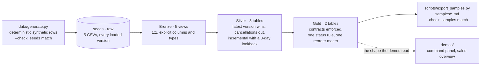

# Reference stack · a runnable Medallion project on DuckDB

[](https://github.com/Fabrizionp/portfolio/actions/workflows/reference-stack.yml)

The case studies describe production systems whose code is private. This directory is the public, runnable
reproduction of their patterns on synthetic data, written from scratch for this portfolio: a dbt project on
DuckDB with Bronze, Silver and Gold layers; the situations a pipeline has to survive (late corrections, status
changes, duplicates, cancellations) built into the data on purpose; one status rule and one reorder macro for the
whole product; enforced contracts on Gold; 45 tests; and a CI job that builds everything from a fresh clone on
every pull request. It is wave 1 of Phase 2 in the [roadmap](ROADMAP.md).

## Run it

Python 3.12 or newer. About two minutes, most of it the install.

```bash
cd reference-stack
python -m venv .venv && source .venv/bin/activate     # Windows: .venv\Scripts\activate
pip install -r requirements.txt
python data/generate.py                                # rewrites dbt/seeds/*.csv, deterministic
cd dbt && dbt deps --profiles-dir . && dbt build --profiles-dir .
cd .. && python scripts/export_samples.py              # rewrites samples/*.md from the build
```

`dbt build` loads the five seeds, builds five Bronze views, three Silver tables and two Gold tables, and runs the
45 tests: 60 steps, about seven seconds on a laptop (a second build takes two). The result is one file,
`dbt/reference_stack.duckdb`, which the DuckDB CLI or Python opens directly.

## What a reader sees without running anything

The Gold output is committed as Markdown and regenerated from the build; CI fails when the two disagree.

| Sample | What it shows |
|---|---|
| [row_counts.md](samples/row_counts.md) | Rows per layer: 4,165 order versions become 4,089 orders; 6,236 line versions become 5,832 sold lines; 6,349 snapshot rows become 6,300 |
| [gld_sales_daily_by_channel.md](samples/gld_sales_daily_by_channel.md) | The last seven days by channel: orders, units, net revenue, cost, gross profit, customers |
| [gld_inventory_needs.md](samples/gld_inventory_needs.md) | The lines to buy or transfer, Critical first, with the quantity in whole cases and the reason when a metric is missing |
| [status_by_channel.md](samples/status_by_channel.md) | How many SKUs sit in each status per channel and the units recommended |

## How it is built



| Layer | Models | Rule |
|---|---|---|
| **raw** (seeds) | `channels`, `products`, `orders`, `order_lines`, `inventory_snapshots` | Every loaded version is kept. 76 orders have two versions (a cancellation arrived later), 126 lines were delivered twice (the second time with the corrected quantity), 49 snapshots were delivered twice. |
| **Bronze** | [`brz_*`](dbt/models/bronze/_bronze.yml) | Views, 1:1 with the source, every column named and typed. No business rule. |
| **Silver** | [`slv_orders`](dbt/models/silver/slv_orders.sql), [`slv_order_lines`](dbt/models/silver/slv_order_lines.sql), [`slv_inventory_daily`](dbt/models/silver/slv_inventory_daily.sql), [`slv_sku_velocity`](dbt/models/silver/slv_sku_velocity.sql) (ephemeral) | The latest `loaded_at` wins. `slv_order_lines` is incremental (`delete+insert` on the line key) and re-reads the last three days of loads on every run, so a late correction replaces its first version instead of sitting next to it. Cancelled orders never become sales. A stocking channel's demand is the sales of the channels it supplies. |
| **Gold** | [`gld_sales_daily_by_channel`](dbt/models/gold/gld_sales_daily_by_channel.sql), [`gld_inventory_needs`](dbt/models/gold/gld_inventory_needs.sql) | [Contracts enforced](dbt/models/gold/_gold.yml): a column cannot change type or disappear without the build failing. Status by [one macro](dbt/macros/stock_status.sql), quantity by [one macro](dbt/macros/reorder_quantity.sql), parameters from the channel row. A missing metric shows its reason, never a 0. |

### The tests, and what each one guards

| Test | Guards |
|---|---|
| [`assert_late_corrections_win`](dbt/tests/assert_late_corrections_win.sql) | Every line delivered twice carries the quantity of the latest load in Silver |
| [`assert_cancelled_orders_are_not_sales`](dbt/tests/assert_cancelled_orders_are_not_sales.sql) | An order whose latest version is cancelled has no sold line, even when its first version said fulfilled |
| [`assert_gold_revenue_reconciles_to_silver`](dbt/tests/assert_gold_revenue_reconciles_to_silver.sql) | Gold equals Silver to the cent |
| [`assert_critical_lines_get_a_recommendation`](dbt/tests/assert_critical_lines_get_a_recommendation.sql) | A Critical line with demand and nothing on order always gets a quantity |
| `a_missing_metric_shows_its_reason` | `days_of_cover` is filled or `days_of_cover_note` says why it is not |
| `recommended_qty_is_whole_cases` | The quantity to order is a multiple of the case size |
| 39 generic tests (`dbt_utils` and built-in) | Keys unique and present, composite keys unique per layer, ranges (no negative stock, revenue or quantity), accepted statuses, foreign keys to channels and products, gross profit equals revenue minus cost |

### What CI does on every pull request

The [`reference-stack` workflow](../.github/workflows/reference-stack.yml), with no secrets and no warehouse account:

1. `python data/generate.py --check`: the committed seeds are exactly what the generator writes (nobody edited a CSV by hand).
2. `timeout 120 dbt build`: the project builds from a fresh clone under the two-minute budget (AC-1), tests included.
3. `dbt build` again: the incremental model is idempotent; a second run changes nothing.
4. `python scripts/export_samples.py --check`: the committed samples are exactly what the second build produces (AC-8).

## Which case-study pattern each part reproduces

| Pattern | In production | Here |
|---|---|---|
| Medallion layers with explicit Bronze mirrors | [CS-01](../case-studies/01-multi-client-dbt-dagster-platform.md) | `dbt/models/bronze`, `silver`, `gold`; `generate_schema_name` names the layers |
| Incremental models with a lookback, dedup on the latest load | [CS-01](../case-studies/01-multi-client-dbt-dagster-platform.md), [CS-04](../case-studies/04-lakehouse-every-15-minutes.md) | `slv_order_lines` (`delete+insert`, `lookback_days`), `slv_orders`, `slv_inventory_daily` |
| A contract between the pipeline and what reads it | [CS-02](../case-studies/02-producer-consumer-contract.md) | dbt contracts enforced on Gold (`_gold.yml`); the generated-types sync is wave 2 |
| Five copies of the purchasing engine became one macro | [CS-02](../case-studies/02-producer-consumer-contract.md), [CS-03](../case-studies/03-inventory-intelligence-product.md) | `stock_status` and `reorder_quantity` serve buying and transfer channels; the channel row supplies lead time, cycle and safety days |
| One status rule, a missing metric shows the reason | [CS-03](../case-studies/03-inventory-intelligence-product.md), [demos](../demos/README.md) | `stock_status`; `days_of_cover_note`; the test `a_missing_metric_shows_its_reason` |
| Reconciliation before a number ships | [CS-03](../case-studies/03-inventory-intelligence-product.md), [CS-05](../case-studies/05-agentic-extraction-platform.md) | `assert_gold_revenue_reconciles_to_silver`; the samples drift check |
| Generated artifacts verified in CI, not trusted | [CS-02](../case-studies/02-producer-consumer-contract.md), [CS-06](../case-studies/06-agentic-delivery-at-scale.md) | `generate.py --check`, `export_samples.py --check` |
| Every change by PR under required checks | [Playbook](../practices/agentic-delivery-playbook.md) | the `reference-stack` and `checks` workflows on this repository |

## Design notes

- **Synthetic on purpose.** The brand, the 42 SKUs, the customers and every number come from a seeded generator.
  The generator plants the hard cases (two versions of an order, corrected lines, duplicate snapshots, cancelled
  orders, SKUs without demand) so the tests have something real to catch. Dates are fixed (`as_of_date` =
  2026-10-31) so the build is reproducible; a recency test would therefore be wrong here and is left out.
- **DuckDB, not a warehouse.** The point is a stack anyone can run in two minutes with no account. The SQL is
  standard where it can be (`qualify`, window functions, `interval`); a Snowflake profile is wave 2.
- **`delete+insert`, not `merge`.** The simplest incremental strategy that makes a late correction replace its
  first version by key, on every adapter. The lookback is a project variable, as in production.
- **Contracts on Gold only.** Gold is what other systems read; Bronze and Silver are free to change shape as long
  as Gold keeps its promise and the reconciliation test holds.
- **Samples as Markdown.** A reviewer should see the output in the browser. Because CI regenerates them, the
  samples cannot drift from the code, which is the same idea as the generated types in CS-02.

## Not here yet

The [roadmap](ROADMAP.md) lists the next waves: the `contract.yml` with generated TypeScript types and a drift
check (wave 2), a per-channel configuration table and the shadow-build zero-diff gate (wave 3), Dagster
definitions with the manifest-driven closure sensor (wave 4), the governance workflows (wave 5), and the
visualization layer over this Gold (Phase 3).
